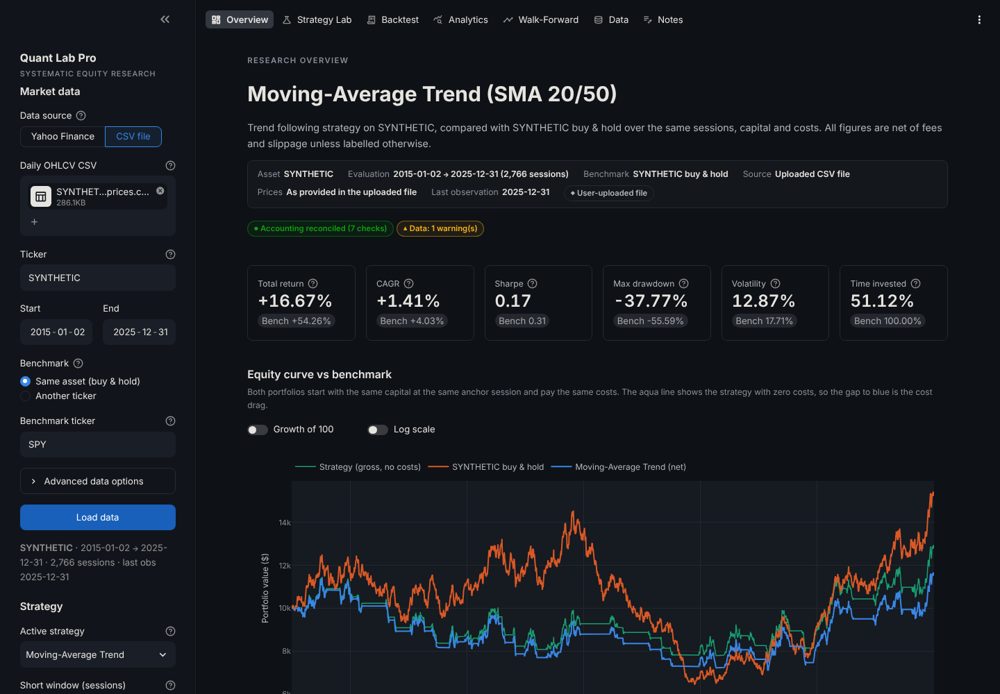
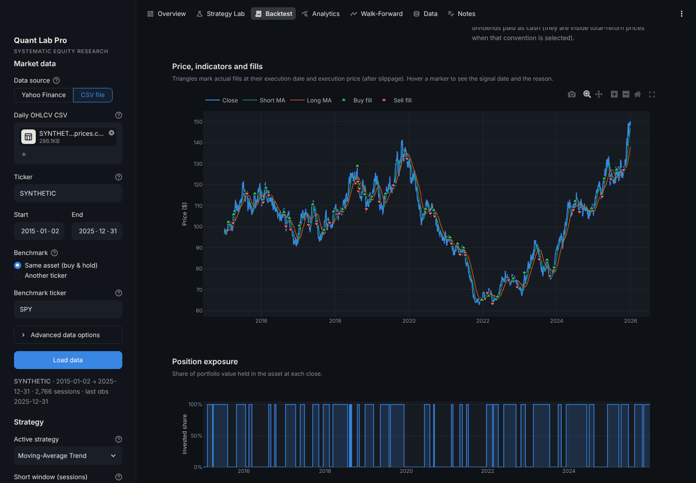
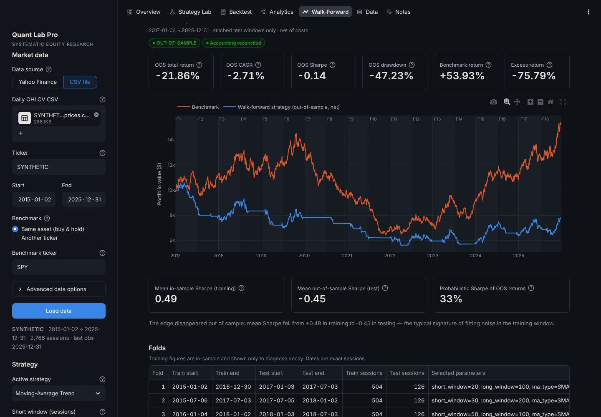
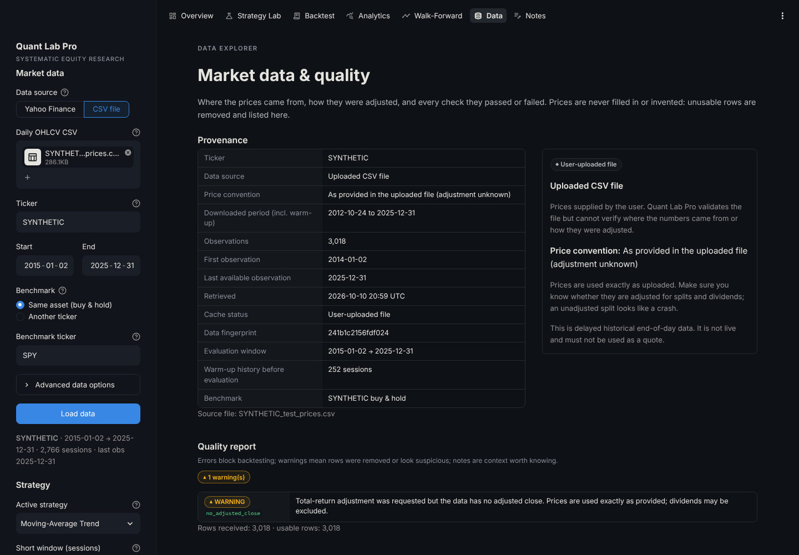

# Quant Lab Pro

**A locally runnable research and backtesting workstation for systematic equity strategies.**

Quant Lab Pro downloads daily price history, validates it, runs systematic trading strategies — from
classic rules to a volatility-targeted trend ensemble and a leakage-safe machine-learning classifier —
through a transparent long-only backtesting engine, and evaluates them with risk metrics, bootstrap
confidence intervals, regime analysis, chronological walk-forward testing and multiple-testing
safeguards. Every number on screen is computed from an auditable trade ledger and equity curve, and the
accounting is reconciled automatically.

> **Research demonstration, not investment advice.** All results are hypothetical backtests on
> historical end-of-day data. Nothing in this application is live market data, it cannot place orders,
> and it connects to no broker. Historical performance does not guarantee future results.

---

## Contents

- [Features](#features)
- [Screenshots](#screenshots)
- [Quick start (macOS)](#quick-start-macos)
- [Running the tests](#running-the-tests)
- [Architecture](#architecture)
- [Strategies](#strategies)
- [Advanced models](#advanced-models)
- [Backtesting assumptions](#backtesting-assumptions)
- [Financial calculation conventions](#financial-calculation-conventions)
- [Market data: sources and limitations](#market-data-sources-and-limitations)
- [Research integrity safeguards](#research-integrity-safeguards)
- [Robustness analytics](#robustness-analytics)
- [Worked example: one trade, by hand](#worked-example-one-trade-by-hand)
- [Reproducing a backtest](#reproducing-a-backtest)
- [Experiments, notes and storage](#experiments-notes-and-storage)
- [Quantitative research concepts demonstrated](#quantitative-research-concepts-demonstrated)
- [Known limitations](#known-limitations)
- [Future improvements](#future-improvements)
- [Why historical performance does not guarantee future results](#why-historical-performance-does-not-guarantee-future-results)
- [Deployment](#deployment)

---

## Features

| Page | What it does |
|---|---|
| **Overview** | Strategy vs benchmark: headline metrics, equity curves (net and zero-cost), drawdowns, key risk indicators, accounting status, probabilistic and deflated Sharpe ratios, and how many configurations you have tried on this sample. |
| **Strategy Lab** | Plain-English guide to each strategy (entry/exit rules, assumptions, failure modes, parameters, references). Out-of-sample diagnostics for the ML model (hit rate vs base rate, AUC, Brier score, coefficients and their stability) and the ensemble. Side-by-side comparison of all strategies on identical terms. Parameter sensitivity heatmaps and transaction-cost sensitivity. |
| **Backtest** | The execution model in full, price chart with fills at their actual execution prices, an auditable trade ledger, a step-by-step trade tracer, round-trip trades, per-check accounting reconciliation, and CSV/JSON exports. |
| **Analytics** | 50+ metrics with definitions and sample-size caveats; drawdown episodes; rolling volatility and Sharpe; monthly heatmap; calendar-year returns; trade-return distribution; gross vs net performance; **robustness**: block-bootstrap confidence intervals and performance by market regime. |
| **Walk-Forward** | Chronological out-of-sample evaluation: parameters selected on training windows only, applied to the following unseen window, stitched into one out-of-sample portfolio. In-sample vs out-of-sample decay and parameter stability. |
| **Data** | Provenance (source, price convention, cache status, fingerprint), a full data-quality report, removed rows, OHLC and volume charts, return statistics, dividend adjustment factor and a trading-calendar check. |
| **Notes** | Save experiments (hypothesis, configuration, metrics, data fingerprint, methodology version), compare them side by side, restore a configuration, keep research notes, export/import JSON and CSV. |

---

## Screenshots

The images in [`docs/screenshots/`](docs/screenshots/) were captured while building the project in a
sandbox **without market-data access**, using a **synthetic random-walk price file** (ticker `SYNTHETIC`).
They show the interface, not real performance. Replace them with screenshots from your own run on real
data (e.g. SPY 2015–today) before publishing.

| Overview | Backtest & ledger |
|---|---|
|  |  |
| **Walk-forward** | **Data quality** |
|  |  |

---

## Quick start (macOS)

Requires **Python 3.11 or newer** (developed and tested on Python 3.13). Check with `python3 --version`;
if needed, install a current Python from [python.org](https://www.python.org/downloads/) or with
Homebrew (`brew install python@3.13`).

```bash
# 1. Get the code
git clone https://github.com/fahdr1428/quanttrader.git
cd quanttrader

# 2. Create and activate a virtual environment (keeps dependencies out of your system Python)
python3 -m venv .venv
source .venv/bin/activate

# 3. Install dependencies
pip install --upgrade pip
pip install -r requirements.txt          # or requirements-dev.txt to also run the tests

# 4. Launch the app (opens http://localhost:8501 in your browser)
streamlit run app.py
```

To keep saved experiments and notes between sessions on your own machine, launch with file storage:

```bash
QLP_STORAGE=sqlite streamlit run app.py
```

The app loads SPY from Yahoo Finance on first visit. If Yahoo Finance is unreachable from your network,
switch **Data source** to **CSV file** and upload daily bars with columns
`Date, Open, High, Low, Close, Volume` (optionally `Adj Close`).

For an exact copy of the tested environment use `pip install -r requirements-lock.txt` instead of step 3.

---

## Running the tests

```bash
source .venv/bin/activate
pip install -r requirements-dev.txt
python -m pytest            # full suite (about 15 seconds, no network needed)
ruff check quantlab ui pages app.py tests scripts   # optional lint
```

The suite (241 tests) uses only synthetic data with known outcomes. It covers:

- **Accounting with hand-calculated expectations** — buy-and-hold, round trips with and without costs,
  whole-share sizing, insufficient cash, open positions marked to market.
- **Timing and look-ahead** — fills use the next session's open (including across price gaps); warm-up
  periods; final-session signals; and a regression test for **every** strategy proving that changing
  future prices cannot change any earlier signal, plus engine-level tests that later prices cannot alter
  earlier fills or valuations.
- **Accounting reconciliation** — the seven identities pass for every strategy and fail when the ledger
  or equity is deliberately corrupted.
- **Randomised stress tests** — 1,500 seeded random scenarios (price gaps, binary and fractional targets,
  whole and fractional shares, costs from zero to 1%, every rebalance band, cash interest) must satisfy
  every accounting identity.
- **Partial positions** — hand-calculated fractional targets, rebalance bands, partial exits, position
  episodes and cash-interest compounding.
- **Model honesty checks** — the logistic regression recovers known coefficients; every refit trains only
  on outcomes already known; on a pure random walk the ML model shows no skill (AUC within 0.42–0.58,
  so an apparent edge on noise would fail the build); on a market with a planted momentum effect it
  detects it (AUC > 0.58); volatility targeting cuts exposure in a turbulent regime.
- **Robustness analytics** — bootstrap reproducibility, block-length behaviour, paired resampling, and
  regime labels that only use information known before each return.
- **Metrics** — annualisation conventions, hand-computed Sharpe/Sortino, drawdown episodes, zero-volatility
  and small-sample handling, benchmark-relative statistics.
- **Data layer** — provider failure modes (rate limit, unknown ticker, network), cache hits/expiry/stale
  fallback/corruption, CSV parsing, adjustment, fingerprints, validation of duplicates, missing and
  non-positive prices, holidays vs genuine gaps.
- **Walk-forward** — chronological, non-overlapping folds; parameter selection unaffected by data after
  the training end; out-of-sample equity unaffected by later prices.
- **Persistence and exports** — SQLite round trips, import/export, credential refusal, exports that match
  results exactly, and manifest-based reproduction.
- **UI smoke tests** — every page renders and the main workflows run (Streamlit `AppTest`).

---

## Architecture

```
quanttrader/
├── app.py                     # Streamlit entry point: page config, shared sidebar, navigation
├── pages/                     # One file per page (presentation only)
│   ├── 1_Research_Overview.py
│   ├── 2_Strategy_Lab.py
│   ├── 3_Backtesting.py
│   ├── 4_Performance_Analytics.py
│   ├── 5_Walk_Forward.py
│   ├── 6_Data_Explorer.py
│   └── 7_Research_Notes.py
├── ui/                        # Streamlit helpers: state & caching, components, Plotly charts, theme
├── quantlab/                  # The quantitative core — no Streamlit imports
│   ├── config.py              # BacktestConfig (pydantic), conventions, methodology version
│   ├── data.py                # Provider interface, Yahoo & CSV providers, cache, adjustment, fingerprint
│   ├── validation.py          # Input validation and the data-quality report
│   ├── calendar.py            # Approximate NYSE calendar (diagnostics only)
│   ├── indicators.py          # Causal SMA, EMA, Wilder RSI, Bollinger bands, trailing returns
│   ├── strategies.py          # Strategy interface + five strategies
│   ├── execution.py           # Fill prices, slippage, fees, sizing
│   ├── portfolio.py           # Cash/share state with no-leverage, no-short constraints
│   ├── backtest.py            # Session loop, ledger, round trips, reconciliation
│   ├── metrics.py             # Performance and risk metrics with sample-size flags
│   ├── analytics.py           # Rolling stats, period tables, comparison, sensitivity
│   ├── ml.py                  # Causal features, purged walk-forward logistic regression, scoring
│   ├── robustness.py          # Stationary block bootstrap, regime analysis
│   ├── research.py            # Walk-forward, probabilistic & deflated Sharpe ratio
│   ├── experiments.py         # SQLite experiment store with migrations
│   ├── reporting.py           # Exports and run manifests (reproducibility)
│   └── serialization.py
├── scripts/reproduce_backtest.py   # Re-run a saved manifest and verify every number
├── scripts/synthetic_model_study.py  # Seeded experiment: do the models find planted signals, and only those?
├── tests/                     # pytest suite (synthetic data only)
├── docs/screenshots/
├── .streamlit/config.toml     # Theme and server settings (no secrets)
├── requirements.txt / requirements-dev.txt / requirements-lock.txt
└── pyproject.toml
```

**Data flow.** `data.py` returns a validated `MarketDataset` → a `Strategy` turns prices into a target
target-weight series (0–1 = share of the portfolio to invest, NaN = warm-up) → `backtest.py` simulates fills and accounting
session by session → `metrics.py` derives every statistic from the resulting equity curve →
`research.py` repeats this chronologically for out-of-sample evaluation.

**Design principles.**

1. *The core never imports the UI.* Every calculation can be scripted, tested and reproduced without
   Streamlit.
2. *Strategies never see execution prices, cash or positions.* They only emit targets, which makes it
   structurally hard for a strategy to peek at the price it will trade at.
3. *Data after the evaluation end is cut off before signals are computed,* so even a non-causal bug could
   not use it.
4. *Nothing is ever filled in.* Invalid rows are removed and reported; missing prices are never invented.
5. *Results are not presented as reliable unless the accounting reconciles.*

**Adding a strategy.** Subclass `Strategy` in `quantlab/strategies.py`, declare `param_specs`, write
`_compute()` returning a `target` column, document it in `doc`, and add the class to `STRATEGY_CLASSES`.
The engine, UI, comparison, sensitivity and walk-forward pick it up automatically; the look-ahead
regression test runs against it too.

**Adding a data provider.** Subclass `DataProvider` in `quantlab/data.py` and implement `fetch()` to
return daily OHLCV for `[start, end]` or raise a `DataProviderError` subclass. Validation, caching,
adjustment and fingerprinting are provider-independent.

---

## Strategies

These are **research hypotheses, not recommendations**, and nothing here claims any of them is profitable.

| Strategy | Idea | Entry | Exit | Defaults | Typical failure mode |
|---|---|---|---|---|---|
| **Buy & Hold** | Benchmark: own the asset | First available open | Never (marked to market) | — | Full depth of bear markets |
| **Moving-Average Trend** | Trends persist | Short MA closes above long MA | Short MA at/below long MA | SMA 20 / 50 | Whipsaws in sideways markets; lag |
| **Time-Series Momentum** | Past 12-month return predicts direction | Trailing return > threshold | Trailing return ≤ threshold | 252 sessions, skip 0, threshold 0% | Momentum crashes at reversals |
| **RSI Mean Reversion** | Oversold moves partially reverse | RSI(14) closes below 30 while flat | RSI closes above 50 while invested | Wilder RSI 14, 30/50 | Falling knives; no stop-loss |
| **Bollinger Mean Reversion** | Price reverts to a local mean | Close below lower band while flat | Close above middle (or upper) band | 20 sessions, 2σ, exit at middle | Trending markets "walk the band" |
| **Adaptive Trend Ensemble** | Diversified trend + volatility targeting | Partial position = vol scale × share of 5 trend votes (+ pullback boost) | Scales down as votes turn negative or volatility rises | 15% vol target, 20-session EWMA, boost 0.25, 20% steps | V-shaped reversals; volatility spikes cut exposure before rebounds |
| **Walk-Forward ML Classifier** | Learned P(up over N sessions) | Partial position rises from 0% at P = 50% to 100% at P = 60% | 0% when P ≤ 50% | 21-session horizon, 3-year window, refit monthly, ridge 0.1 | Regime change; weak, unstable patterns; overfitting via tuning |

The two mean-reversion strategies hold their state between entry and exit thresholds, so a persistent
condition (e.g. RSI below 30 for a week) creates one order, not one per day. The engine also only
trades when the target differs from the current holding. Invalid parameters (short window ≥ long window,
RSI entry ≥ exit, non-integer windows, out-of-range values) are rejected with an explanation.

Each strategy page shows whether parameters are the pre-specified defaults or were changed. Changed
parameters are treated as potentially tuned after seeing results unless you explicitly declare otherwise.

---

## Advanced models

Both advanced models size positions continuously (0–100%) and move their target only in whole steps,
and only once the underlying signal has moved a full step — a hysteresis rule that stops a signal hovering
near a boundary from trading every day. Combined with the engine's rebalance band, this keeps the
ensemble's turnover in the same range as the simple moving-average strategy despite its partial positions
(roughly 5–8× a year vs 5–6× on the synthetic test data; without hysteresis it was several times higher).

**Adaptive Trend Ensemble.** Five trend votes — the sign of the trailing 1-, 3-, 6- and 12-month return
and whether price is above its 200-session average — form a trend score between 0 and 1. That score is
multiplied by a volatility scale, `min(1, target volatility / EWMA realised volatility)`, so exposure
shrinks in turbulent markets and is never levered. An optional pullback boost adds exposure when RSI(3)
is below 20 while price is above its 200-session average. Grounded in Moskowitz, Ooi & Pedersen (2012),
Hurst, Ooi & Pedersen (2017) and Moreira & Muir (2017).

**Walk-Forward ML Classifier.** An L2-regularised logistic regression (Newton's method, implemented in
NumPy in `quantlab/ml.py`) estimates the probability that the price is higher 21 sessions ahead from
twelve causal features: 1-day to 12-month returns, 1-month volatility, the short/long volatility ratio,
distance from the 50- and 200-session averages, RSI(14) and drawdown from the 1-year high.

| Safeguard | Implementation |
|---|---|
| Causal features | Every feature at session *t* uses closes up to *t* |
| Purged labels | A refit at session *r* trains only on samples *s ≤ r − horizon*, whose outcome was already known |
| No scaling leakage | Feature means and standard deviations come from the training window only |
| Walk-forward refits | Rolling 756-session window, refit every 21 sessions, frozen in between — every prediction is out-of-sample |
| Regularisation | Ridge penalty on standardised coefficients; a small, economically motivated feature set |
| Honest scoring | Hit rate vs the "always predict the majority" base rate, AUC, Brier score vs climatology, and the effective sample size (overlapping labels shrink it by roughly the horizon) |
| Stability check | How often each coefficient keeps its sign across refits |
| Turnover control | Probabilities smoothed with a 5-session EWMA; targets move in 20% steps with hysteresis |

**How good are they? A controlled experiment.** `python scripts/synthetic_model_study.py` builds seeded
synthetic markets with a *known* process and reports each strategy's net Sharpe ratio (evaluation after a
700-session warm-up, default parameters and costs):

| Market | Seed | Buy & hold | MA 20/50 | Ensemble | ML classifier | ML AUC | ML hit-rate edge |
|---|---|---|---|---|---|---|---|
| Noise (no signal) | 1 | +0.28 | +0.40 | +0.05 | +0.15 | 0.457 | −3.7% |
| Noise (no signal) | 2 | −0.29 | −0.27 | −0.32 | −0.37 | 0.539 | −1.7% |
| Noise (no signal) | 3 | +0.15 | +0.20 | +0.03 | −0.79 | 0.416 | −6.7% |
| Weak momentum | 1 | +0.27 | +0.71 | +0.53 | +0.58 | 0.554 | +1.6% |
| Weak momentum | 2 | −0.48 | +0.32 | −0.04 | −0.13 | 0.554 | −1.1% |
| Weak momentum | 3 | +0.14 | +0.61 | +0.55 | −0.15 | 0.460 | −1.1% |
| Moderate momentum | 1 | +0.39 | +1.32 | +0.82 | +0.93 | 0.627 | +9.6% |
| Moderate momentum | 2 | −0.61 | +0.43 | +0.19 | −0.01 | 0.638 | +0.2% |
| Moderate momentum | 3 | +0.04 | +1.07 | +1.00 | +0.71 | 0.580 | +7.7% |

What this shows — and does not show:

- On **pure noise** the ML model finds no skill (AUC around 0.5, hit rate below the base rate) — the
  behaviour you want; a leaking model would look brilliant here.
- With a **planted effect** it detects the structure (AUC 0.58–0.64) and the trend models beat buy and
  hold on a risk-adjusted basis, most clearly when the effect is stronger.
- **More complex is not automatically better.** The planted process *is* a trend rule, so the simple
  moving-average crossover captures it best; the ensemble's volatility targeting adds nothing in a market
  whose volatility never changes, and the ML model pays for its flexibility with noisier positions.
- Synthetic results say nothing about real markets. They test that the machinery works and that the
  models cannot manufacture an edge from noise. Use the walk-forward page and the robustness tab on real
  data before believing any result.

---

## Backtesting assumptions

| Assumption | Default | Configurable |
|---|---|---|
| Initial capital | $10,000 | Yes |
| Transaction fee | 0.10% of traded notional per execution | Yes |
| Slippage | 0.05% per execution, adverse (buys above, sells below the open) | Yes |
| Execution timing | Signal at the close of session *t*, fill at the **open of session *t + 1*** | — |
| Position model | Long-only, unleveraged; target weight between 0% and 100% (rule-based strategies are all-in or all-cash) | — |
| Rebalancing | Partial positions trade only when the held weight drifts more than 5 points from target; entries and full exits always trade | Yes |
| Share sizing | Fractional shares (whole-shares option available) | Yes |
| Cash interest | 0% (optionally a fixed annual rate on idle cash, accrued each session) | Yes |
| Risk-free rate | 0% p.a. (used only in Sharpe/Sortino) | Yes |
| End of sample | Open positions marked to market at the final close; a final-session signal is reported as unexecuted | — |
| Benchmark | Buy & hold (same asset or another ticker) through the **same engine, costs and sessions** | Yes |

**Session lifecycle.** At each open, any order queued from the previous close fills. At each close, the
portfolio is valued (`equity = cash + shares × close`), then the strategy's target is compared with
the holding: if different, an order is queued for the next open. The first session of the evaluation
window is the *anchor*: the portfolio is in cash at its close. When an evaluation start date is given,
the anchor is the last session before it, so indicators can be warmed up on earlier history (loaded
automatically, 800 calendar days by default — enough for the ML model's ~524-session warm-up) and a signal known on the eve of the period can be acted on
at its first open.

**Sizing.** A strategy asks for a target weight. A buy acquires the value needed to reach it at the fill
price but never spends more than the cash available including the fee, so a 100% target from cash
spends everything: `quantity = cash / (open × (1 + slippage) × (1 + fee))`. A partial sell reduces holdings
to the target; a 0% target sells the whole position. With whole shares, quantities are rounded down and
infeasible rebalances are skipped rather than retried every session.

**Accounting reconciliation.** After every backtest seven identities are checked: equity = cash + shares ×
close each session; cash and shares never negative; initial capital + ledger cash flows + cash interest =
final cash; ledger quantities = final shares; daily P&L = overnight move on prior shares + interest +
intraday move on current shares − fees − slippage; fees in the daily record = fees in the ledger; every fill executes on the
session immediately after its signal. A failure is shown prominently and the results are labelled
unreliable.

**Trade ledger fields.** Signal date, execution date, side, target weight, quantity, reference price (open), execution
price, gross notional, fee, slippage cost, net cash flow, cash and shares before and after, and the
reason (e.g. *"SMA20 (412.10) closed above SMA50 (410.33)"*).

---

## Financial calculation conventions

All metrics are computed from the daily equity series. `N` = number of daily returns after the anchor.

| Metric | Definition |
|---|---|
| Daily return | `r_t = E_t / E_{t−1} − 1` |
| Total return | `E_T / E_0 − 1` (net of all costs) |
| Annualised return (CAGR) | `(E_T / E_0)^(252 / N) − 1` — geometric, 252 sessions per year |
| Annualised volatility | `std(r, ddof=1) × √252` |
| Sharpe ratio | `mean(r − rf_d) / std(r − rf_d) × √252`, with `rf_d = (1 + rf)^(1/252) − 1` |
| Sortino ratio | `mean(r − rf_d) / DD × √252`, `DD = √mean(min(r − rf_d, 0)²)` over all observations |
| Maximum drawdown | `min_t (E_t / max_{s≤t} E_s − 1)` |
| Drawdown duration | Sessions (and calendar days) from a peak until it is regained, or until the sample ends |
| Calmar ratio | CAGR / \|max drawdown\| |
| Turnover (annualised) | Total traded notional (buys + sells) / average equity / years |
| Time invested | Share of sessions ending with a non-zero position |
| Trade net return | Per position episode (cash → invested → cash, including partial rebalances): (all sale proceeds net of fees) / (all purchase costs including fees) − 1 |
| Win rate | Share of closed trades with positive net return |
| Gross vs net | The same signals re-simulated with zero fees and slippage; the difference is the cost drag |
| Beta, correlation, tracking error, information ratio | From daily strategy and benchmark returns over identical sessions |
| Best/worst periods | Calendar day, month and year; first and last periods may be partial |

**Undefined and small-sample cases.** Ratios with zero volatility are reported as *n/a* with an
explanation rather than as infinity. Annualised figures with fewer than 252 observations, ratios with
fewer than 60, Sortino with fewer than 20 below-target days, and trade statistics with fewer than 10
closed trades are shown with an asterisk and a note. Portfolio-level returns (which include time in cash)
and trade-level returns (per round trip) are reported separately.

---

## Market data: sources and limitations

**Yahoo Finance via `yfinance`.** Free, unofficial end-of-day data. It can be rate-limited, temporarily
unavailable, revised after the fact, and is sometimes blocked from cloud-hosting IP ranges. It is not
live data and must not be used as a quote.

**Splits and dividends.** Yahoo reports `Close` (split-adjusted only) and `Adj Close` (split- and
dividend-adjusted). In the default **total-return** convention, open, high, low and close are each
multiplied by `Adj Close / Close`, so dividends are effectively reinvested and every price in the
backtest is on one consistent basis. Consequences you should know:

- Historical adjusted prices are not the prices that actually traded, and they **change every time a new
  dividend is paid**. Percentage returns are unaffected (all costs are proportional), but absolute share
  prices and quantities in the ledger are on the adjusted scale.
- The **price-return** option ignores dividends and understates buy-and-hold for income-paying assets.
- CSV uploads are used as provided; the app cannot know whether they were adjusted.

**Validation before any backtest.** Ticker and date checks; required columns; date parsing and
timezone normalisation; chronological sorting; duplicate timestamps (identical copies collapsed,
conflicting copies removed); missing or non-numeric prices removed; non-positive prices removed; negative
volume set to missing; high/low inconsistencies and moves above 25% flagged; gaps of more than 7 calendar
days flagged; weekdays that are not NYSE holidays but have no data listed for review; stale data
(last observation well before the requested end) flagged. Removed rows are listed individually.
A weekday without data is **not** assumed to be missing: it is first compared with an approximate NYSE
holiday calendar.

**Caching.** Validated downloads are cached on disk for 24 hours (with SHA-256 integrity checks) and
in memory for 6 hours. If the provider fails, a previously cached copy is used and clearly labelled
*stale*. The data source, cache status and last available observation are shown on every page.

**Benchmark alignment.** When the benchmark is a different ticker, both series are restricted to their
common sessions; a date present in only one series is dropped from both and disclosed, never filled.

**Survivorship bias.** You choose tickers that exist today. Delisted companies — often the worst
performers — are invisible, which flatters any test on a hand-picked list of current stocks. Broad ETFs
such as SPY reduce, but do not remove, this issue.

---

## Research integrity safeguards

| Risk | How it is handled |
|---|---|
| **Look-ahead bias** | Causal indicators; next-open execution; data after the evaluation end removed before signals are computed; regression tests that alter future prices; a reconciliation check that every fill follows its signal by one session. |
| **Survivorship bias** | Documented above; the app cannot see delisted securities. |
| **Overfitting / repeated tuning** | Session trial counter; deflated Sharpe ratio across your trials; parameter-selection disclosure; sensitivity analysis labelled in-sample; walk-forward evaluation. |
| **Data snooping** | Constrained search spaces (≤150 sensitivity combinations, ≤100 walk-forward combinations); warnings about multiple testing; defaults fixed in code before any data is seen. |
| **Transaction-cost sensitivity** | Every result is net; gross twin shown; cost sweep from 0× to 10× with the break-even level. |
| **Slippage uncertainty** | Fixed-percentage estimate, configurable, included in the cost sweep. |
| **Regime dependence** | Rolling volatility and Sharpe; calendar-year returns; fold-by-fold walk-forward results; performance split by trend and volatility regime. |
| **Luck vs skill** | Stationary block bootstrap: confidence intervals for Sharpe, CAGR and drawdown, and the probability of beating the benchmark. |
| **ML leakage** | Purged labels, train-window-only feature scaling, frozen walk-forward refits, and a test that the model finds no skill on pure noise. |
| **Benchmark selection** | Same-asset buy & hold by default (isolates the value of timing); any other ticker optional; identical engine, costs and sessions. |
| **Corporate actions** | Explicit total-return or price-return convention; adjustment factor chart; extreme-move warnings for possible unadjusted splits. |
| **Small samples** | Asterisks and notes on statistics with too few observations or trades; probabilistic Sharpe ratio accounting for length, skew and kurtosis. |
| **Backtest vs live** | Disclaimer on every page; known limitations listed below. |

**Walk-forward procedure.** The evaluation period is divided into consecutive folds (rolling or
anchored training windows followed by a test window). For each fold, every combination in a small grid
is backtested on the training window only — the price history is truncated at the training end before any
signal is computed. The best combination by the chosen objective (Sharpe, CAGR, Calmar or total return;
ties broken by grid order) is applied to the next, unseen test window. Test windows are stitched into a
single out-of-sample portfolio using the same engine and costs. The exact training and test dates of every
fold, the data cut-off used for selection, in-sample and out-of-sample results, and parameter stability
are all shown. Only the out-of-sample curve is evidence; in-sample figures are shown to diagnose decay.

**Probabilistic and deflated Sharpe.** The probabilistic Sharpe ratio (Bailey & López de Prado, 2012)
estimates the probability that the true Sharpe ratio exceeds a threshold given sample length, skewness
and kurtosis. The deflated Sharpe ratio raises that threshold to the Sharpe you would expect from the best
of *N* configurations with no real edge. It assumes independent trials, so treat it as indicative.

---

## Robustness analytics

**Bootstrap (Analytics → Robustness).** The strategy's daily returns are resampled 500–2,000 times with a
stationary block bootstrap (Politis & Romano, 1994): random-length blocks with a mean of 21 sessions, so
volatility clustering and short-term autocorrelation survive. Benchmark returns are resampled on the same
days, preserving their correlation. The page reports 5th/50th/95th percentiles of Sharpe, annualised
return, volatility, maximum drawdown and excess return, the probability that Sharpe is positive, the
probability of beating the benchmark, and a bad-case drawdown. A fixed seed makes it reproducible. The
bootstrap assumes the return process is stationary, so its intervals are a lower bound on true
uncertainty.

**Regimes.** Each day's return is grouped by the benchmark's state at the previous close: above or below
its 200-session average, and 63-session volatility above or below its sample median (the median uses
hindsight, so that split is descriptive). Strategy and benchmark annualised return, volatility and Sharpe
are shown per regime, revealing strategies whose edge comes from one kind of market.

---

## Worked example: one trade, by hand

A six-session example (synthetic prices) run through the actual engine with the default settings:
$10,000 capital, 0.10% fee, 0.05% slippage, fractional shares. The strategy's target is *invested* at the
closes of sessions 1–3 and *cash* from session 4.

| Session | Open | Close | Target at close | What happens | Equity at close |
|---|---|---|---|---|---|
| Mon 4 Mar | 100.00 | 100.50 | invested | Anchor: in cash. Order queued for next open | $10,000.00 |
| Tue 5 Mar | 101.00 | 103.00 | invested | **Buy** at 101.00 × 1.0005 = **101.0505** | $10,182.74 |
| Wed 6 Mar | 104.00 | 107.00 | invested | Hold (no new order) | $10,578.19 |
| Thu 7 Mar | 108.00 | 105.00 | cash | Exit signal at the close; order queued | $10,380.46 |
| Fri 8 Mar | 103.00 | 102.50 | cash | **Sell** at 103.00 × 0.9995 = **102.9485** | $10,167.47 |
| Mon 11 Mar | 102.00 | 103.50 | cash | Flat | $10,167.47 |

- **Quantity** = 10,000 / (101.0505 × 1.001) = **98.861559** shares; gross notional $9,990.01; fee $9.99;
  slippage cost 98.861559 × 0.0505 = $4.99; cash afterwards $0.00.
- **Valuation** on Tuesday: 98.861559 × 103.00 = $10,182.74.
- **Sale**: 98.861559 × 102.9485 = $10,177.65 gross; fee $10.18; cash $10,167.47.
- **Trade return**: 10,167.47 / 10,000 − 1 = **+1.67% net**, versus a +1.98% move in the reference
  price (101 → 103). The exit decision was taken at Thursday's $105 close but could only be executed at
  Friday's $103 open — the overnight gap is a real cost that a "trade at the signal close" backtest would
  hide.
- All seven reconciliation checks pass. The same arithmetic is asserted in `tests/test_backtest.py`.

---

## Reproducing a backtest

1. On the **Backtest** page, download the *Run manifest (JSON)* and *Prices used (CSV)*.
2. Re-run and verify:

```bash
# Exact, offline reproduction from the exported prices
python scripts/reproduce_backtest.py --manifest SPY_ma_crossover_..._manifest.json --prices SPY_..._prices.csv

# Or re-download from the provider recorded in the manifest
python scripts/reproduce_backtest.py --manifest SPY_ma_crossover_..._manifest.json
```

The script reports whether the **data fingerprint** (SHA-256 of the prices used), the **methodology
version**, the accounting checks and each headline metric match the recorded values.

The engine is fully deterministic and uses no randomness (no seeds are needed; the only random number
generators in the project are seeded test fixtures). The limit to reproducibility is the data: Yahoo
revises history and rescales adjusted prices after every dividend, so a fresh download can differ from
the original. A fingerprint mismatch tells you this happened; the exported CSV gives an exact
reproduction regardless.

---

## Experiments, notes and storage

The **Notes** page records an experiment's name, hypothesis, observations, limitations and conclusion,
together with the ticker, sample period, data source, price convention, data fingerprint, last
observation, strategy and parameters, cost configuration, all metrics, the parameter-selection
disclosure, the number of configurations tried on that sample, and the app and methodology versions.
Experiments can be compared side by side (with a warning when methodology versions differ), exported as
JSON or CSV, imported, and restored into the sidebar.

| `QLP_STORAGE` | Where records live | Use for |
|---|---|---|
| `session` (default) | In-memory SQLite private to one browser session | Public deployments: one visitor can never see another's records |
| `sqlite` | `data/quant_lab_research.db` | Running on your own computer |

Free-text fields that look like credentials (API keys, tokens, passwords) are refused. The app collects
no personal data and sends no telemetry (`gatherUsageStats = false`).

---

## Quantitative research concepts demonstrated

Talking points for interviews, each implemented and tested in this codebase:

- **Look-ahead bias prevention** — causal indicators, next-open execution, truncation of future data
  before signal generation, and a regression test proving future prices cannot change past signals.
- **Realistic execution modelling** — overnight gaps, adverse slippage, proportional fees on actual
  traded notional, target-weight sizing that respects fees, rebalance bands, cash interest, whole-share
  constraints and order rejection.
- **Volatility targeting and signal combination** — a multi-horizon trend ensemble scaled by an EWMA
  volatility forecast, with hysteresis quantisation to control turnover.
- **Leakage-safe machine learning** — purged labels, train-only scaling, walk-forward refits, honest
  out-of-sample scoring (AUC, Brier vs climatology, effective sample size) and coefficient-stability
  diagnostics, plus a controlled experiment showing the model finds planted signals but not noise.
- **Resampling inference** — stationary block bootstrap confidence intervals and regime attribution.
- **Property-based testing** — 1,500 randomised scenarios checked against accounting invariants.
- **Double-entry style reconciliation** — seven accounting identities including a daily P&L attribution
  into overnight and intraday components.
- **Separation of signal and execution** — strategies emit target exposures; the engine owns prices,
  cash and positions; stateful (hysteresis) signals prevent order churn.
- **Risk-adjusted performance measurement** — Sharpe, Sortino, Calmar, drawdown depth and duration,
  beta, tracking error and information ratio, with explicit annualisation conventions.
- **Statistical humility** — sample-size flags, probabilistic Sharpe ratio, deflated Sharpe ratio for
  multiple testing, and a session trial counter.
- **Out-of-sample methodology** — rolling and anchored walk-forward analysis with train-only parameter
  selection and in-sample vs out-of-sample decay diagnostics.
- **Robustness analysis** — parameter-sensitivity surfaces and transaction-cost break-even analysis.
- **Data engineering for finance** — corporate-action adjustment, trading-calendar awareness, validation
  that never fabricates prices, provider abstraction, caching with integrity checks, and fingerprints
  for detecting vendor revisions.
- **Reproducible research** — run manifests, methodology versioning, deterministic computation and a
  verification script.
- **Software engineering** — a UI-independent core, typed configuration with validation, 241 automated
  tests including UI smoke tests, and a lint-clean codebase.

---

## Known limitations

- Single-asset, long-only strategies (partial positions between 0% and 100% are supported). No shorting,
  leverage, or portfolio construction across several assets.
- Daily bars only. Fills are assumed at the open with fixed-percentage slippage; there is no volume
  constraint, market-impact model, partial fills, auction dynamics or intraday stops.
- Cash interest is a single fixed rate set by the user, not a historical T-bill series.
- No taxes, borrowing costs or dividend withholding; dividends are reinvested implicitly when
  total-return prices are used.
- Free Yahoo Finance data: unofficial, can be rate-limited or blocked (especially from cloud servers),
  and is revised after the fact. Survivorship bias applies to any ticker you choose today.
- The NYSE calendar is an approximation and is used only for diagnostics.
- The deflated Sharpe ratio assumes independent trials; parameter variants are correlated, so it is
  indicative only. The trial counter covers the current browser session only.
- Walk-forward results are still a single historical path, and the strategy ideas and grids were chosen
  by people who have seen market history.
- The ML model is deliberately simple (linear in its features). Its default settings were chosen on
  economic grounds, not tuned; on real data it may well show no skill — the diagnostics will say so.
- The bootstrap assumes stationarity and cannot anticipate regimes absent from the sample.
- This build was verified with synthetic data in an environment without access to Yahoo Finance; the live
  download path is covered by tests with a simulated provider and by the error handling observed against a
  blocked network. Run it once on your own machine to confirm live downloads.

## Future improvements

1. Multi-asset portfolios (cross-sectional momentum, risk parity) with portfolio-level rebalancing.
2. Historical T-bill series for cash interest and the risk-free rate; short selling with borrow costs.
3. A volume-aware market-impact model and limit-order / close-auction execution options.
4. Additional providers (e.g. a paid vendor with point-in-time, survivorship-free constituents).
5. Combinatorially purged cross-validation (López de Prado) for model selection.
6. Non-linear models (gradient-boosted trees) behind the same purged walk-forward harness, compared with
   the linear model on identical out-of-sample terms.
7. Meta-labelling: an ML model that sizes or filters the trades of a rule-based strategy.
8. User accounts with private persistent storage for the hosted version.

---

## Why historical performance does not guarantee future results

A backtest answers one narrow question: *how would these exact rules have behaved on this exact
historical path, under these assumptions?* It cannot tell you how the rules will behave on a path that
has not happened yet. Markets change (regimes, participants, regulation, technology); strategies that
worked attract capital that arbitrages them away; the specific history you tested is only one draw from
many possible histories; and every choice you made after looking at the data — the asset, the period,
the parameters, even the decision to test this strategy at all — quietly fits the past. Real trading
adds frictions this model omits and the very human difficulty of sticking with a strategy through a
long drawdown. Treat every result here as evidence about a hypothesis, never as a forecast.

---

## Deployment

The app is ready for **Streamlit Community Cloud** (entry point `app.py`, dependencies in
`requirements.txt`, no secrets required). See **[DEPLOYMENT.md](DEPLOYMENT.md)** for step-by-step
instructions, free-tier constraints, troubleshooting, and the checklist of changes to make before
publishing the repository.

The application has **not** been deployed as part of this build.
