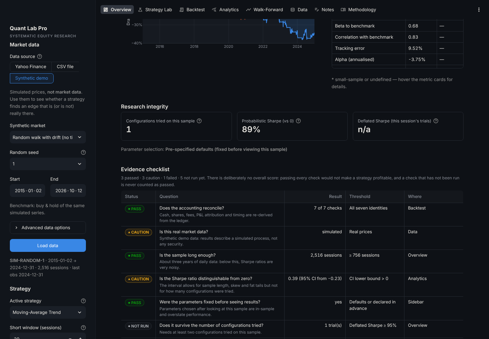
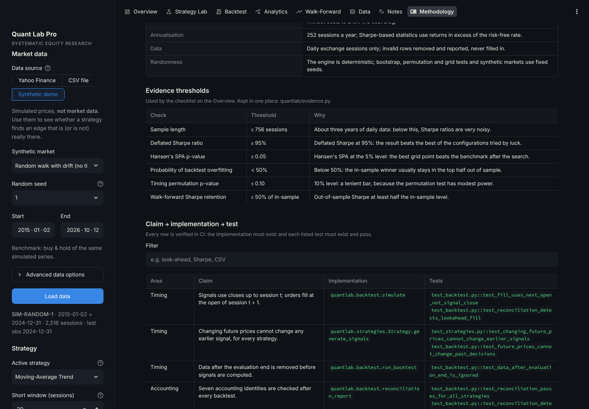

# Quant Lab Pro

**A locally runnable research and backtesting workstation for systematic equity strategies.**

Quant Lab Pro downloads daily price history, validates it, runs systematic trading strategies — from
classic rules to a volatility-targeted trend ensemble and a leakage-safe machine-learning classifier —
through a transparent long-only backtesting engine, and asks hard questions of every result: Sharpe
ratio confidence intervals and HAC t-statistics, bootstrap intervals, an exposure-matched benchmark and a
timing permutation test, chronological walk-forward testing, and multiple-testing corrections
(deflated Sharpe, probability of backtest overfitting, Hansen's SPA and Romano–Wolf). Every number on
screen is computed from an auditable trade ledger and equity curve, and the accounting is reconciled
automatically. A clearly labelled synthetic-data mode lets the whole app be explored offline.

It also includes a **research agent** with seven operating modes — RESEARCH, SCAN, ALERTS, BACKTEST,
PAPER TRADE, PORTFOLIO REVIEW and POST-TRADE REVIEW — built on the same tested engine plus
provenance-tagged fundamentals (SEC EDGAR and Yahoo Finance), technical indicators, risk-based position
sizing with hard limit checks, a simulated paper account and a deterministic ten-section research report.
An optional AI analyst (Claude, with your own API key) orchestrates those tools; its report is checked
against the tool results — every number and link must be traceable to them — and withheld when it fails.

> **Research demonstration, not investment advice.** All results are hypothetical backtests on
> historical end-of-day data. Nothing in this application is live market data, it cannot place orders,
> and it connects to no broker; paper trades are simulated. Historical performance does not guarantee
> future results.

---

## Contents

- [Features](#features)
- [Screenshots](#screenshots)
- [Quick start (macOS)](#quick-start-macos)
- [Running the tests](#running-the-tests)
- [Architecture](#architecture)
- [Strategies](#strategies)
- [Advanced models](#advanced-models)
- [Backtesting assumptions](#backtesting-assumptions)
- [Financial calculation conventions](#financial-calculation-conventions)
- [Market data: sources and limitations](#market-data-sources-and-limitations)
- [Research integrity safeguards](#research-integrity-safeguards)
- [Robustness analytics](#robustness-analytics)
- [Worked example: one trade, by hand](#worked-example-one-trade-by-hand)
- [Reproducing a backtest](#reproducing-a-backtest)
- [Experiments, notes and storage](#experiments-notes-and-storage)
- [Research agent](#research-agent)
- [Quantitative research concepts demonstrated](#quantitative-research-concepts-demonstrated)
- [Known limitations](#known-limitations)
- [Future improvements](#future-improvements)
- [Why historical performance does not guarantee future results](#why-historical-performance-does-not-guarantee-future-results)
- [Deployment](#deployment)

---

## Features

| Page | What it does |
|---|---|
| **Overview** | Strategy vs benchmark: headline metrics, equity curves (net and zero-cost), drawdowns, key risk indicators including the Sharpe ratio's 95% confidence interval and the alpha t-statistic, accounting status, probabilistic and deflated Sharpe ratios, how many configurations you have tried on this sample, and an **evidence checklist**: every robustness question the app can ask, with its threshold and whether the result passed, failed or has not been tested yet. |
| **Strategy Lab** | Plain-English guide to each strategy (entry/exit rules, assumptions, failure modes, parameters, references). Out-of-sample diagnostics for the ML model (hit rate vs base rate, AUC, Brier score, coefficients and their stability) and the ensemble. Side-by-side comparison of all strategies on identical terms. Parameter-sensitivity heatmaps with **selection-bias tests over the whole grid** (probability of backtest overfitting, Hansen's SPA, Romano–Wolf p-values), and transaction-cost sensitivity. |
| **Backtest** | The execution model in full, price chart with fills at their actual execution prices, an auditable trade ledger, a step-by-step trade tracer, round-trip trades, per-check accounting reconciliation, and CSV/JSON exports. |
| **Analytics** | 60+ metrics with definitions and sample-size caveats, including **statistical inference** (Sharpe standard error and interval, minimum track record, Newey–West t-statistics, CAPM alpha/beta) and **tail risk** (VaR, expected shortfall, Cornish–Fisher VaR, skew, kurtosis); drawdown episodes; rolling volatility and Sharpe; monthly heatmap; calendar-year returns; trade-return distribution; gross vs net performance; **robustness**: block-bootstrap intervals, an exposure-matched benchmark, a timing permutation test and performance by market regime. |
| **Walk-Forward** | Chronological out-of-sample evaluation: parameters selected on training windows only, applied to the following unseen window, stitched into one out-of-sample portfolio. In-sample vs out-of-sample decay, parameter stability, and a deflated Sharpe across the walk-forward specifications you have tried. |
| **Data** | Provenance (source, price convention, cache status, fingerprint), a full data-quality report, removed rows, OHLC and volume charts, return statistics, dividend adjustment factor and a trading-calendar check. For synthetic data, the true data-generating process. |
| **Notes** | Save experiments (hypothesis, configuration, metrics, data fingerprint, methodology version), compare them side by side, restore a configuration (with a fingerprint check), keep research notes, export/import JSON and CSV. |
| **Agent** | The seven operating modes, each stating its required inputs before it runs: a ten-section **research report** with documented setup rules, data-quality gating and an evidence-confidence rating; universe **scans**; on-demand **alert** checks; **backtests**; a **simulated paper account** with thesis-linked stops and targets; **portfolio review** of uploaded holdings; and **post-trade review** in R multiples. Risk limits are yours (illustrative and labelled until you confirm them). The optional AI analyst shows its tool calls and a verification panel. |
| **Methodology** | The conventions behind every number, the evidence thresholds, and a searchable **claim → implementation → test** table: each methodological claim (timing, accounting, data handling, statistics, multiple testing, ML leakage, reproducibility, privacy) with the function that implements it and the tests that fail if it stops being true. |

---

## Screenshots

The images in [`docs/screenshots/`](docs/screenshots/) were captured from the app's **synthetic demo mode**
(ticker `SIM-RANDOM-1`: a simulated random walk with drift and **no** timing signal, labelled SYNTHETIC in
the app). They show the interface, not the performance of any real security. On this market the
moving-average rule trails buy & hold, and its walk-forward Sharpe falls from 0.86 in training to −0.16 out of
sample: what fitting noise looks like. Real-data screenshots should be taken from your own run before
publishing.

| Overview | Evidence checklist |
|---|---|
|  |  |
| **Backtest & fills** | **Walk-forward** |
|  |  |
| **Data & known data-generating process** | **Methodology & traceability** |
|  |  |

---

## Quick start (macOS)

Requires **Python 3.11 or newer** (developed and tested on Python 3.13). Check with `python3 --version`;
if needed, install a current Python from [python.org](https://www.python.org/downloads/) or with
Homebrew (`brew install python@3.13`).

```bash
# 1. Get the code
git clone https://github.com/fahdr1428/quanttrader.git
cd quanttrader

# 2. Create and activate a virtual environment (keeps dependencies out of your system Python)
python3 -m venv .venv
source .venv/bin/activate

# 3. Install dependencies
pip install --upgrade pip
pip install -r requirements.txt          # or requirements-dev.txt to also run the tests

# 4. Launch the app (opens http://localhost:8501 in your browser)
streamlit run app.py
```

To keep saved experiments and notes between sessions on your own machine, launch with file storage:

```bash
QLP_STORAGE=sqlite streamlit run app.py
```

The app loads SPY from Yahoo Finance on first visit. If Yahoo Finance is unreachable from your network,
either switch **Data source** to **CSV file** and upload daily bars with columns
`Date, Open, High, Low, Close, Volume` (optionally `Adj Close`), or press **Explore with synthetic demo
data** to use simulated prices (labelled *SYNTHETIC* on every page — they are not market data).

For an exact copy of the tested environment use `pip install -r requirements-lock.txt` instead of step 3.

---

## Running the tests

```bash
source .venv/bin/activate
pip install -r requirements-dev.txt
python -m pytest            # full suite (about two minutes on a laptop, no network needed)
ruff check quantlab ui pages app.py tests scripts   # optional lint
```

The suite (900 tests) uses only synthetic data with known outcomes. It covers:

- **Accounting with hand-calculated expectations** — buy-and-hold, round trips with and without costs,
  whole-share sizing, insufficient cash, open positions marked to market.
- **Timing and look-ahead** — fills use the next session's open (including across price gaps); warm-up
  periods; final-session signals; and a regression test for **every** strategy proving that changing
  future prices cannot change any earlier signal, plus engine-level tests that later prices cannot alter
  earlier fills or valuations.
- **Accounting reconciliation** — the seven identities pass for every strategy and fail when the ledger
  or equity is deliberately corrupted.
- **Randomised stress tests** — 1,500 seeded random scenarios (price gaps, binary and fractional targets,
  whole and fractional shares, costs from zero to 1%, rebalance bands from 0% to 20%, cash interest) must
  satisfy every accounting identity.
- **Partial positions** — hand-calculated fractional targets, rebalance bands, partial exits, position
  episodes measured on the capital committed, and cash-interest compounding.
- **Model honesty checks** — the logistic regression recovers known coefficients; every refit trains only
  on outcomes already known; averaged over eight seeds, the ML model shows **no positive skill on pure
  noise** (a leak would push its AUC above 0.5) and a mean AUC clearly above 0.5 with a planted momentum
  effect; volatility targeting cuts exposure in a turbulent regime; every exposure step reaches 0% and 100%.
- **Statistical tests are calibrated, not just implemented** — the Sharpe standard error matches a Monte
  Carlo within 7%; PBO averages 0.5 on noise; on 150 grids of 20 pure-noise configurations (500
  sessions) SPA and Romano–Wolf rejected 4.7% of the time at the 5% level and the Reality Check 8.0%
  (it is slightly liberal in short samples), while planted effects are found; the timing permutation test
  is calibrated on zero-drift noise. PBO, the bootstrap tests and the inference functions are also checked
  against slow, explicit reference implementations.
- **Robustness analytics** — bootstrap reproducibility, block-length behaviour, paired resampling, and
  regime labels that only use information known before each return.
- **Metrics** — annualisation conventions, hand-computed Sharpe/Sortino, drawdown episodes, zero-volatility
  and small-sample handling, benchmark-relative statistics, and PSR/DSR on excess returns.
- **Data layer** — provider failure modes (rate limit, unknown ticker, network), cache hits/expiry/stale
  fallback/corruption/collisions, unfinished-session handling, CSV dialects (European, US and ISO dates,
  UTC offsets, thousands separators, decimal commas, BOMs), refusal of weekly, intraday and seven-day
  data, dividend-adjustment consistency, fingerprints, and validation of duplicates, missing and
  non-positive prices, holidays vs genuine gaps.
- **Walk-forward** — chronological, non-overlapping folds; parameter selection unaffected by data after
  the training end; out-of-sample equity unaffected by later prices.
- **Persistence and exports** — SQLite round trips, idempotent import/export, credential refusal, exports
  that match results exactly, and manifest-based reproduction (including offline reproduction of a
  synthetic run through the script).
- **UI** — every page and tab renders (Streamlit `AppTest`); trial counting, persisted settings, stale
  results flags, the demo mode without network access, and a scan for text that would render as LaTeX.
- **Research agent** — fundamentals through fake Yahoo and SEC transports (label mapping, a restated value
  and point-in-time `as_of` rebuilds, filing links, the required User-Agent, caching and typed errors);
  metrics, position sizes, gap risk and R multiples checked by hand; limit checks that fail closed; paper
  fills that never use the decision bar and gap through stops, and a database constraint that makes every
  paper row simulated; the report's gating and confidence caps; tool schemas valid for strict tool use;
  the agent loop with a scripted fake client (mode scoping, refusals, truncation, budgets, invented
  numbers withheld, API keys redacted); and the agent page's passcode and per-session run limit.

Many tests are regression tests for defects found in an adversarial audit of this codebase (85 of 86
reported issues were confirmed by independent reproduction and fixed); each reproduces the original
failure.

---

## Architecture

```
quanttrader/
├── app.py                     # Streamlit entry point: page config, shared sidebar, navigation
├── pages/                     # One file per page (presentation only)
│   ├── 1_Research_Overview.py
│   ├── 2_Strategy_Lab.py
│   ├── 3_Backtesting.py
│   ├── 4_Performance_Analytics.py
│   ├── 5_Walk_Forward.py
│   ├── 6_Data_Explorer.py
│   ├── 7_Research_Notes.py
│   ├── 8_Methodology.py
│   └── 9_Research_Agent.py    # The seven agent modes and the optional AI analyst
├── ui/                        # Streamlit helpers: state & caching, components, Plotly charts, theme
├── quantlab/                  # The quantitative core — no Streamlit imports
│   ├── config.py              # BacktestConfig (pydantic), conventions, methodology version
│   ├── data.py                # Provider interface; Yahoo, CSV and synthetic providers; cache; adjustment; fingerprint
│   ├── validation.py          # Input validation and the data-quality report
│   ├── calendar.py            # Approximate NYSE calendar (diagnostics only)
│   ├── indicators.py          # Causal SMA, EMA, Wilder RSI, Bollinger bands, trailing returns
│   ├── strategies.py          # Strategy interface + seven strategies (incl. buy & hold, ensemble, ML)
│   ├── execution.py           # Fill prices, slippage, fees, sizing
│   ├── portfolio.py           # Cash/share state with no-leverage, no-short constraints
│   ├── backtest.py            # Session loop, ledger, round trips, reconciliation
│   ├── metrics.py             # Performance and risk metrics with sample-size flags
│   ├── analytics.py           # Rolling stats, period tables, comparison, sensitivity, grid selection tests
│   ├── inference.py           # Sharpe SE/CI, minimum track record, Newey-West, alpha/beta, VaR/CVaR
│   ├── ml.py                  # Causal features, purged walk-forward logistic regression, scoring
│   ├── nulls.py               # Exposure-matched benchmark, timing permutation test
│   ├── overfitting.py         # Probability of backtest overfitting (CSCV)
│   ├── significance.py        # White's Reality Check, Hansen's SPA, Romano-Wolf stepdown
│   ├── robustness.py          # Stationary block bootstrap, regime analysis
│   ├── research.py            # Walk-forward, probabilistic & deflated Sharpe ratio
│   ├── simulation.py          # Synthetic markets with a known data-generating process
│   ├── evidence.py            # Evidence checklist: thresholds and pass / caution / fail / not run
│   ├── traceability.py        # Claim -> implementation -> test map (checked by tests/test_traceability.py)
│   ├── experiments.py         # SQLite experiment store with migrations (v2 adds the paper-trading ledger)
│   ├── provenance.py          # Provenance, Fact and Calculated: source, timeliness, period, units, warnings
│   ├── technicals.py          # Causal MACD, ATR, relative strength, volume z-score, 52-week range, snapshot
│   ├── signals.py             # Signal definitions (hypothesis ... limitations) and current signal state
│   ├── scan.py / alerts.py    # SCAN and ALERTS modes on validated end-of-day data
│   ├── fundamentals.py        # Yahoo and SEC EDGAR providers, point-in-time statements, ratios, quality checks
│   ├── risk.py                # Risk limits, position sizing, gap risk, risk/reward, limit checks
│   ├── holdings.py            # PORTFOLIO REVIEW: concentration, correlation, VaR, scenarios, liquidity
│   ├── paper.py / postmortem.py   # Simulated paper account; post-trade review against each thesis
│   ├── research_report.py     # Deterministic ten-section RESEARCH report and confidence rubric
│   ├── agent/                 # Tools (strict schemas, per-mode), guardrails, Claude tool loop, audit log
│   ├── reporting.py           # Exports and run manifests (reproducibility)
│   └── serialization.py
├── scripts/reproduce_backtest.py   # Re-run a saved manifest and verify every number
├── scripts/synthetic_model_study.py  # Seeded experiment: do the models find planted signals, and only those?
├── tests/                     # pytest suite (synthetic data only)
├── docs/agent_role.md         # The agent's role and rules (its system prompt)
├── docs/AGENT_DESIGN.md       # Agent module contracts
├── docs/screenshots/
├── .streamlit/config.toml     # Theme and server settings (no secrets)
├── requirements.txt / requirements-dev.txt / requirements-lock.txt
└── pyproject.toml
```

**Data flow.** `data.py` returns a validated `MarketDataset` → a `Strategy` turns prices into a
target-weight series (0–1 = share of the portfolio to invest, NaN = warm-up) → `backtest.py` simulates fills and accounting
session by session → `metrics.py` derives every statistic from the resulting equity curve →
`research.py` repeats this chronologically for out-of-sample evaluation.

**Design principles.**

1. *The core never imports the UI.* Every calculation can be scripted, tested and reproduced without
   Streamlit.
2. *Strategies emit targets and never see cash, positions or fills.* They do receive the whole price
   frame, so causality — no use of anything after the close of the signal session, including the next
   open they will trade at — is enforced by a test that perturbs future prices for every registered
   strategy and requires identical signals.
3. *Data after the evaluation end is cut off before signals are computed,* so even a non-causal bug could
   not use it.
4. *Nothing is ever filled in.* Invalid rows are removed and reported; missing prices are never invented.
5. *Results are not presented as reliable unless the accounting reconciles.*

**Adding a strategy.** Subclass `Strategy` in `quantlab/strategies.py`, declare `param_specs`, write
`_compute()` returning a `target` column, document it in `doc`, and add the class to `STRATEGY_CLASSES`.
The engine, UI, comparison, sensitivity and walk-forward pick it up automatically; the look-ahead
regression test runs against it too.

**Adding a data provider.** Subclass `DataProvider` in `quantlab/data.py` and implement `fetch()` to
return daily OHLCV for `[start, end]` or raise a `DataProviderError` subclass. Validation, caching,
adjustment and fingerprinting are provider-independent.

---

## Strategies

These are **research hypotheses, not recommendations**, and nothing here claims any of them is profitable.

| Strategy | Idea | Entry | Exit | Defaults | Typical failure mode |
|---|---|---|---|---|---|
| **Buy & Hold** | Benchmark: own the asset | First available open | Never (marked to market) | — | Full depth of bear markets |
| **Moving-Average Trend** | Trends persist | Short MA closes above long MA | Short MA at/below long MA | SMA 20 / 50 | Whipsaws in sideways markets; lag |
| **Time-Series Momentum** | Past 12-month return predicts direction | Trailing return > threshold | Trailing return ≤ threshold | 252 sessions, skip 0, threshold 0% | Momentum crashes at reversals |
| **RSI Mean Reversion** | Oversold moves partially reverse | RSI(14) closes below 30 while flat | RSI closes above 50 while invested | Wilder RSI 14, 30/50 | Falling knives; no stop-loss |
| **Bollinger Mean Reversion** | Price reverts to a local mean | Close below lower band while flat | Close above middle (or upper) band | 20 sessions, 2σ, exit at middle | Trending markets "walk the band" |
| **Adaptive Trend Ensemble** | Diversified trend + volatility targeting | Partial position = vol scale × share of 5 trend votes (+ pullback boost) | Scales down as votes turn negative or volatility rises | 15% vol target, 20-session EWMA, boost 0.25, 20% steps | V-shaped reversals; volatility spikes cut exposure before rebounds |
| **Walk-Forward ML Classifier** | Learned P(up over N sessions) | Partial position rises from 0% at P = 50% to 100% at P = 60% | 0% when P ≤ 50% | 21-session horizon, 3-year window, refit monthly, ridge 0.1 | Regime change; weak, unstable patterns; overfitting via tuning |

The two mean-reversion strategies hold their state between entry and exit thresholds, so a persistent
condition (e.g. RSI below 30 for a week) creates one order, not one per day. The engine also only
trades when the target differs from the current holding. Invalid parameters (short window ≥ long window,
RSI entry ≥ exit, non-integer windows, out-of-range values) are rejected with an explanation.

Each strategy page shows whether parameters are the pre-specified defaults or were changed. Changed
parameters are treated as potentially tuned after seeing results unless you explicitly declare otherwise.

---

## Advanced models

Both advanced models size positions continuously (0–100%) and move their target only in whole steps
(divisors of 100%, so fully invested and flat are always reachable), and only once the underlying signal
has moved a full step — a hysteresis rule that stops a signal hovering near a boundary from trading every
day. On ten 1,500-session synthetic random walks the ensemble's annualised turnover was 5.6–10.5× (median
7.8×) against 4.6–7.5× (median 5.7×) for the 20/50 moving-average crossover; without the hysteresis rule
the ensemble's turnover roughly doubles (median ratio 2.1×).

**Adaptive Trend Ensemble.** Five trend votes — the sign of the trailing 1-, 3-, 6- and 12-month return
and whether price is above its 200-session average — form a trend score between 0 and 1. That score is
multiplied by a volatility scale, `min(1, target volatility / EWMA realised volatility)`, so exposure
shrinks in turbulent markets and is never levered. An optional pullback boost adds exposure when RSI(3)
is below 20 while price is above its 200-session average. Grounded in Moskowitz, Ooi & Pedersen (2012),
Hurst, Ooi & Pedersen (2017) and Moreira & Muir (2017).

**Walk-Forward ML Classifier.** An L2-regularised logistic regression (Newton's method, implemented in
NumPy in `quantlab/ml.py`) estimates the probability that the *tradeable* return — from the next open to
the close 21 sessions later, the move a signal at today's close can actually capture — is positive, from
twelve causal features: 1-day to 12-month returns, 1-month volatility, the short/long volatility ratio,
distance from the 50- and 200-session averages, RSI(14) and drawdown from the 1-year high.

| Safeguard | Implementation |
|---|---|
| Causal features | Every feature at session *t* uses closes up to *t* |
| Purged labels | A refit at session *r* trains only on samples *s ≤ r − horizon*, whose outcome was already known |
| No scaling leakage | Feature means and standard deviations come from the training window only |
| Walk-forward refits | Rolling 756-session window (at least 252), refit every 21 sessions, frozen in between — every prediction is out-of-sample. A refit whose window holds only one outcome class keeps the previous model rather than dropping to cash |
| Regularisation | Ridge penalty on standardised coefficients; a small, economically motivated feature set |
| Honest scoring | Hit rate vs the "always predict the majority" base rate, AUC, Brier score vs climatology, and the effective sample size (overlapping labels shrink it by roughly the horizon) |
| Stability check | How often each coefficient keeps its sign across refits |
| Turnover control | Probabilities smoothed with a 5-session EWMA; targets move in 20% steps with hysteresis |

**How good are they? A controlled experiment.** `python scripts/synthetic_model_study.py` builds seeded
synthetic markets with a *known* process — pure noise, and a planted time-series-momentum effect at two
strengths — and runs every model on **20 independent paths per market** (3,000 sessions each, evaluated
after a 700-session warm-up, default parameters and costs). Mean ± standard deviation across paths:

| Market | Buy & hold Sharpe | MA 20/50 Sharpe | Ensemble Sharpe | ML Sharpe | Beats buy & hold Sharpe (MA / Ens. / ML) | ML AUC | AUC > 0.5 | ML hit-rate edge |
|---|---|---|---|---|---|---|---|---|
| Noise (no signal) | +0.06 ± 0.32 | −0.00 ± 0.32 | −0.15 ± 0.27 | −0.07 ± 0.41 | 50% / 15% / 30% | 0.489 ± 0.046 | 40% | −3.1% |
| Weak momentum | +0.01 ± 0.44 | +0.34 ± 0.34 | +0.19 ± 0.35 | −0.03 ± 0.44 | 80% / 70% / 45% | 0.494 ± 0.053 | 40% | −2.6% |
| Moderate momentum | −0.04 ± 0.61 | +0.73 ± 0.39 | +0.58 ± 0.40 | +0.40 ± 0.41 | 100% / 95% / 80% | 0.557 ± 0.061 | 75% | +2.1% |

What this shows — and does not show:

- On **pure noise** no model beats buy & hold on average, and the ML model shows no skill (mean AUC just
  below 0.5, hit rate below the base rate) — the behaviour you want; a leaking model would look brilliant
  here. (A pooled AUC over one path is biased slightly *below* 0.5 for persistent predictions, because
  later predictions depend on the moves that formed earlier labels.)
- A **weak** planted effect is picked up by the simple trend rules but **not** by the ML model, whose AUC
  is indistinguishable from noise.
- A **moderate** effect is detected by the ML model on average (AUC 0.56), but not reliably on any single
  path: a quarter of the paths still show an AUC at or below 0.5.
- **More complex is not automatically better.** The planted process *is* a trend rule, so the simple
  moving-average crossover captures it best; the ensemble's volatility targeting adds nothing in a market
  whose volatility never changes, and the ML model pays for its flexibility with noisier positions.
- The spread across paths is large: one 9-year path can easily show a Sharpe ratio 0.4 away from the
  average. Synthetic results say nothing about real markets; they test that the machinery works and that
  the models cannot manufacture an edge from noise.

---

## Backtesting assumptions

| Assumption | Default | Configurable |
|---|---|---|
| Initial capital | $10,000 | Yes |
| Transaction fee | 0.10% of traded notional per execution | Yes |
| Slippage | 0.05% per execution, adverse (buys above, sells below the open) | Yes |
| Execution timing | Signal at the close of session *t*, fill at the **open of session *t + 1*** | — |
| Position model | Long-only, unleveraged; target weight between 0% and 100% (rule-based strategies target 0% or 100%; with whole shares, leftover cash can lead to one top-up buy when price moves push the held weight outside the band) | — |
| Rebalancing | Partial positions trade only when the held weight drifts more than 5 points from target; entries and full exits always trade | Yes |
| Share sizing | Fractional shares (whole-shares option available) | Yes |
| Cash interest | 0% (optionally a fixed annual rate on idle cash, accrued each session) | Yes |
| Risk-free rate | 0% p.a. (used only in Sharpe/Sortino) | Yes |
| End of sample | Open positions marked to market at the final close; a final-session signal is reported as unexecuted | — |
| Rejected entries | A whole-share entry the cash cannot cover is rejected (with the reason) and retried once an entry becomes affordable at a close | — |
| Benchmark | Buy & hold (same asset or another ticker) through the **same engine, costs and sessions** | Yes |

**Session lifecycle.** At each open, any order queued from the previous close fills. At each close, the
portfolio is valued (`equity = cash + shares × close`), then the strategy's target is compared with
the holding: if different, an order is queued for the next open. The first session of the evaluation
window is the *anchor*: the portfolio is in cash at its close. When an evaluation start date is given,
the anchor is the last session before it, so indicators can be warmed up on earlier history (loaded
automatically, 800 calendar days by default — enough for the ML model's ~524-session warm-up) and a signal known on the eve of the period can be acted on
at its first open.

**Results do not depend on how much history was loaded.** Recursive indicators are seeded at the first
loaded close, and the mean-reversion and ensemble strategies carry a position state (hysteresis,
deadbands) into the evaluation window. Measured on 60 random walks, changing *only* the amount of
warm-up history changed signals in 6–18 of them (final value by up to 8.6%). So the EMA is a finite
exponential kernel of three spans (weights renormalised; older closes carried < 0.25% of the weight),
and every rule-based strategy declares how much history it needs (`history_sessions`: indicator
convergence plus a 252-session burn-in for stateful strategies; e.g. RSI 392, ensemble 504). With that
much history, loading more changes no signal (tested for every rule-based strategy). The integrity panel
warns when less is loaded. The ML model is the exception: its refit schedule is anchored to the first
session with complete features, so its results depend on where the data starts, and the panel says so.

**Sizing.** A strategy asks for a target weight. A buy acquires the value needed to reach it at the fill
price but never spends more than the cash available including the fee, so a 100% target from cash
spends everything: `quantity = cash / (open × (1 + slippage) × (1 + fee))`. A partial sell reduces holdings
to the target; a 0% target sells the whole position. With whole shares, quantities are rounded down and
infeasible rebalances are skipped rather than retried every session. A drift rebalance is decided on the
signal-day close; its ledger reason also reports the weight at the open where it actually traded.

**Accounting reconciliation.** After every backtest seven identities are checked: equity = cash + shares ×
close each session; cash and shares never negative; initial capital + ledger cash flows + cash interest =
final cash; ledger quantities = final shares; daily P&L = overnight move on prior shares + interest +
intraday move on current shares − fees − slippage; fees in the daily record = fees in the ledger; every fill executes on the
session immediately after its signal. A failure is shown prominently and the results are labelled
unreliable.

**Trade ledger fields.** Signal date, execution date, side, target weight, quantity, reference price (open), execution
price, gross notional, fee, slippage cost, net cash flow, cash and shares before and after, and the
reason (e.g. *"SMA20 (412.10) closed above SMA50 (410.33)"*).

---

## Financial calculation conventions

All metrics are computed from the daily equity series. `N` = number of daily returns after the anchor.

| Metric | Definition |
|---|---|
| Daily return | `r_t = E_t / E_{t−1} − 1` |
| Total return | `E_T / E_0 − 1` (net of all costs) |
| Annualised return (CAGR) | `(E_T / E_0)^(252 / N) − 1` — geometric, 252 sessions per year |
| Annualised volatility | `std(r, ddof=1) × √252` |
| Sharpe ratio | `mean(r − rf_d) / std(r − rf_d) × √252`, with `rf_d = (1 + rf)^(1/252) − 1` |
| Sortino ratio | `mean(r − rf_d) / DD × √252`, `DD = √mean(min(r − rf_d, 0)²)` over all observations |
| Maximum drawdown | `min_t (E_t / max_{s≤t} E_s − 1)` |
| Drawdown duration | Sessions (and calendar days) from a peak until it is regained, or until the sample ends |
| Calmar ratio | CAGR / \|max drawdown\| |
| Turnover (annualised) | Total traded notional (buys + sells) / average equity / years |
| Time invested / average exposure | Share of sessions ending with a non-zero position / mean of holdings ÷ equity |
| Entries and exits | Times the position moved between flat and invested (resizing fills are not counted) |
| Trade net return | Per position episode (cash → invested → cash, including partial rebalances): P&L / capital committed, where capital committed is the peak net cash invested during the episode (money recycled by rebalancing counts once) |
| Sharpe standard error and 95% interval | `SE = √((1 − γ₃·SR + (γ₄ − 1)/4·SR²) / (N − 1))` on per-period excess returns (Lo 2002; Mertens 2002), annualised; interval `SR ± 1.96·SE`. The skew/kurtosis term is never allowed below its normal-returns value `1 + SR²/2`: it can widen the interval but not narrow it, because for rarely invested strategies noisy sample skew otherwise made PSR reject a zero Sharpe about 10% of the time instead of 5% (measured; 5.2% with the floor). The interval, PSR and minimum track record are flagged as unreliable when fewer than 252 sessions carried market exposure, whatever the window length |
| Probabilistic Sharpe; minimum track record | `Φ(SR / SE)`; years of data needed for the observed Sharpe to be significant at 95% (Bailey & López de Prado 2012) |
| Newey–West t-statistics | Mean excess return and CAPM alpha/beta with Bartlett-kernel HAC standard errors |
| VaR, expected shortfall | Historical 5th percentile of daily returns and the mean below it; Cornish–Fisher VaR adjusts the normal quantile for skew and kurtosis |
| Win rate | Share of closed trades with positive net return |
| Gross vs net | The same signals re-simulated with zero fees and slippage; the difference is the cost drag |
| Beta, correlation, tracking error, information ratio | From daily strategy and benchmark returns over identical sessions |
| Best/worst periods | Calendar day, month and year; first and last periods may be partial |

**Undefined and small-sample cases.** Ratios with zero volatility are reported as *n/a* with an
explanation rather than as infinity. Annualised return, turnover and the inference and tail statistics
with fewer than 252 observations, volatility and ratios with fewer than 60, Sortino with fewer than 20
below-target days, and trade statistics with fewer than 10 closed trades are shown with an asterisk and a
note. All Sharpe-based statistics — including PSR, DSR, the trial Sharpes behind DSR (recomputed at the
current rate, never frozen at the rate in force when a trial ran) and the regime Sharpes — use returns in
excess of the configured risk-free rate. Portfolio-level returns (which include time in cash)
and trade-level returns (per round trip) are reported separately.

---

## Market data: sources and limitations

**Yahoo Finance via `yfinance`.** Free, unofficial end-of-day data. It can be rate-limited, temporarily
unavailable, revised after the fact, and is sometimes blocked from cloud-hosting IP ranges. It is not
live data and must not be used as a quote.

**Splits and dividends.** Yahoo reports `Close` (split-adjusted only) and `Adj Close` (split- and
dividend-adjusted). In the default **total-return** convention, open, high, low and close are each
multiplied by `Adj Close / Close`, so dividends are effectively reinvested and every price in the
backtest is on one consistent basis. Consequences you should know:

- Historical adjusted prices are not the prices that actually traded, and they **change every time a new
  dividend is paid**. Percentage returns are unaffected (all costs are proportional), but absolute share
  prices and quantities in the ledger are on the adjusted scale.
- The **price-return** option ignores dividends and understates buy-and-hold for income-paying assets.
- **Adjustment checks.** When the provider reports dividends, the step in `Adj Close / Close` on each
  ex-date is compared with them; an adjusted close that ignores them, or a step far from the dividend
  size, is flagged.
- **CSV uploads follow the selected convention.** Under total return a file with an `Adj Close` column is
  scaled by `Adj Close / Close`; a file without one is used exactly as provided, with a warning, because
  the app cannot tell whether it was adjusted. Price-only uploads are labelled *as provided*, never
  *split-adjusted*. The date format is detected from the whole column (ISO, US, European, `YYYYMMDD`,
  with or without a time and UTC offset); ambiguous day/month order is refused rather than guessed.
  Separators, thousands separators, decimal commas and common encodings are recognised; the decimal mark
  is read from how the numbers are written (a volume such as 1,234,567 in a tab-separated file is not a
  decimal comma), and a file that mixes both conventions is refused. Weekly, intraday (several clock times
  on one date) and seven-day (crypto/FX) files are refused, because the engine assumes daily exchange
  sessions.

**Validation before any backtest.** Ticker and date checks; required columns; date parsing and
timezone normalisation; chronological sorting; duplicate timestamps (identical copies collapsed,
conflicting copies removed); missing or non-numeric prices removed; non-positive prices removed; negative
volume set to missing; high/low inconsistencies and moves above 25% flagged; gaps of more than 7 calendar
days flagged; weekdays that are not NYSE holidays but have no data listed for review; stale data
(last observation well before the requested end) flagged; rows with unreadable dates or values disclosed.
Removed rows are listed individually. While the exchange session is still open, Yahoo reports today as a
bar whose "close" is only the latest price; that bar is dropped and the drop disclosed, using the
exchange's own closing time, and a download missing it expires from the cache once the session closes.
A weekday without data is **not** assumed to be missing: it is first compared with an approximate NYSE
holiday calendar.

**Caching.** Validated downloads are cached on disk for 24 hours (SHA-256 integrity checks, keys that
cannot collide between tickers, old entries pruned) and in memory for 6 hours; *Bypass cache* replaces
the shared copy. If the provider fails, the cached copy for that ticker that covers most of the request —
even one saved for a different end date — is used and clearly labelled *stale* (unreadable cache files are
skipped). The data source, cache status and last
available observation are shown on every analysis page and in the sidebar.

**Synthetic demo data.** *Data source → Synthetic demo* simulates prices from a known process
(GARCH(1,1) volatility with Student-t shocks on the NYSE calendar, 2000–2024, fixed seeds): a market with
no timing signal and one with a planted momentum effect. It exists so the app can be explored offline and
so you can check that a strategy finds an edge only where one exists. Simulated prices are labelled
*SYNTHETIC* on every page, are never written to the market-data cache, and the Data page shows the true
data-generating process.

**Benchmark alignment.** When the benchmark is a different ticker, both series are restricted to their
common date range and sessions; a date present in only one series is dropped from both and disclosed,
never filled. Different price conventions between asset and benchmark are flagged.

**Survivorship bias.** You choose tickers that exist today. Delisted companies — often the worst
performers — are invisible, which flatters any test on a hand-picked list of current stocks. Broad ETFs
such as SPY reduce, but do not remove, this issue.

---

## Research integrity safeguards

| Risk | How it is handled |
|---|---|
| **Look-ahead bias** | Causal indicators; next-open execution; data after the evaluation end removed before signals are computed; regression tests that alter future prices; a reconciliation check that every fill follows its signal by one session. |
| **Survivorship bias** | Documented above; the app cannot see delisted securities. |
| **Overfitting / repeated tuning** | Session trial counter (de-duplicated: a setting that does not change the returns is not a new trial; grouped by the asset's evaluated prices, so changing only the benchmark does not reset it); deflated Sharpe ratio across your trials; a separate counter and deflated Sharpe for walk-forward specifications; parameter-selection disclosure bound to the exact parameters declared; sensitivity analysis labelled in-sample and flagged when stale, and grid or walk-forward results run with other costs never counted in the evidence checklist; walk-forward evaluation. |
| **Data snooping** | Every sensitivity grid is tested as a family: probability of backtest overfitting (CSCV), Hansen's SPA against the benchmark and cash, and Romano–Wolf family-wise p-values per combination. Constrained search spaces (≤150 sensitivity combinations, ≤100 walk-forward combinations); defaults fixed in code before any data is seen. |
| **Exposure vs timing** | An exposure-matched constant-weight benchmark and a circular-shift permutation test separate "less market risk" from timing skill. |
| **Transaction-cost sensitivity** | Every result is net; gross twin shown; cost sweep from 0× to 10× with the break-even level. |
| **Slippage uncertainty** | Fixed-percentage estimate, configurable, included in the cost sweep. |
| **Regime dependence** | Rolling volatility and Sharpe; calendar-year returns; fold-by-fold walk-forward results; performance split by trend and volatility regime. |
| **Luck vs skill** | Sharpe standard error and interval, minimum track record, HAC t-statistics; stationary block bootstrap intervals for Sharpe, CAGR and drawdown, and the probability of beating the benchmark. |
| **ML leakage** | Purged labels on the tradeable return, train-window-only feature scaling, frozen walk-forward refits, and multi-seed tests that the model shows no positive skill on pure noise. |
| **Benchmark selection** | Same-asset buy & hold by default (isolates the value of timing); any other ticker optional; identical engine, costs and sessions. |
| **Corporate actions** | Explicit total-return or price-return convention; adjustment factor chart; extreme-move warnings for possible unadjusted splits. |
| **Small samples** | Asterisks and notes on statistics with too few observations or trades; Sharpe intervals and probabilistic Sharpe ratio accounting for length, skew and kurtosis; minimum-sample rules on the evaluation window itself. |
| **Backtest vs live** | Disclaimer on every page; known limitations listed below. |

**Evidence checklist.** The Overview gathers the checks into one list — accounting, data quality, sample
length, the Sharpe interval, pre-specified parameters, the deflated Sharpe, the exposure-matched benchmark,
the timing permutation test, SPA and PBO on a grid, walk-forward retention and regime consistency — each
with an explicit threshold (`quantlab/evidence.py`) and a pointer to the page that runs it. A check whose
analysis has not been run is shown as *not run*, never as passed, and there is deliberately no overall
score: passing every check would still not make a strategy profitable.

**Traceability.** The Methodology page lists each methodological claim with the code that implements it
and the tests behind it (`quantlab/traceability.py`). `tests/test_traceability.py` fails if a referenced
function or test is renamed or removed, so the page cannot silently drift from the code; the rest of the
suite checks that those tests pass.

**Walk-forward procedure.** The evaluation period is divided into consecutive folds (rolling or
anchored training windows followed by a test window). For each fold, every combination in a small grid
is backtested on the training window only — the price history is truncated at the training end before any
signal is computed. The best combination by the chosen objective (Sharpe, CAGR, Calmar or total return;
ties broken by grid order) is applied to the next, unseen test window. Test windows are stitched into a
single out-of-sample portfolio using the same engine and costs. The exact training and test dates of every
fold, the data cut-off used for selection, in-sample and out-of-sample results, and parameter stability
are all shown. Only the out-of-sample curve is evidence; in-sample figures are shown to diagnose decay.

**Probabilistic and deflated Sharpe.** The probabilistic Sharpe ratio (Bailey & López de Prado, 2012)
estimates the probability that the true Sharpe ratio exceeds a threshold given sample length, skewness
and kurtosis. The deflated Sharpe ratio raises that threshold to the Sharpe you would expect from the best
of *N* configurations with no real edge. It assumes independent trials, so treat it as indicative.

**Selection-bias tests on a grid.** After a sensitivity run the Strategy Lab tests the whole grid at once.
The *probability of backtest overfitting* (Bailey, Borwein, López de Prado & Zhu, 2017) splits the sample
into 12 blocks and, over all 924 ways to choose half of them as in-sample, measures how often the in-sample
winner ranks in the bottom half out of sample (a winner exactly at the median counts as half, so pure
noise gives 50% for any grid size; counting it in full gave 67% for a three-point grid). It says whether
choosing among these combinations is informative, not whether any edge exists, and it is not computed
when every combination produced the same returns. *Hansen's SPA* (2005) asks whether the best combination beats
the benchmark (or cash) once the search over all of them is accounted for; its bootstrap paths are
re-studentised, which brought its measured false-positive rate at 500 sessions from 14% to about 5%.
*Romano–Wolf* stepdown p-values control the chance of any false discovery across the grid. All three
share one stationary bootstrap so the correlation between combinations is kept.

---

## Robustness analytics

**Bootstrap (Analytics → Robustness).** The strategy's daily returns are resampled 500–2,000 times with a
stationary block bootstrap (Politis & Romano, 1994): random-length blocks with a mean of 21 sessions, so
volatility clustering and short-term autocorrelation survive. Benchmark returns are resampled on the same
days, preserving their correlation. The page reports 5th/50th/95th percentiles of Sharpe, annualised
return, volatility, maximum drawdown and excess return, the probability that Sharpe is positive, the
probability of beating the benchmark, and a bad-case drawdown. A fixed seed makes it reproducible. The
bootstrap assumes the return process is stationary and cannot see regime changes or how the strategy was
chosen, so its intervals likely understate the true uncertainty.

**Timing skill, or just less exposure?** A strategy that is often in cash shows smaller drawdowns and
lower volatility than buy & hold without any timing skill. The Robustness tab therefore compares it with a
portfolio that holds the strategy's *average* exposure at all times (same engine, costs and sessions) and,
on request, runs a **timing permutation test**: the strategy's own positions are circularly shifted
200 times, which keeps exposure, turnover and holding periods but breaks their alignment with returns.
The p-value is the share of shifted paths that did at least as well. The test's power is modest, and on
windows shorter than about two years it rejects too often on pure noise; the page says so.

**Regimes.** Each day's return is grouped by the benchmark's state at the previous close: above or below
its 200-session average, and 63-session volatility above or below its median over the evaluation window
(the median uses hindsight, so that split is descriptive). Strategy and benchmark annualised return,
volatility and Sharpe are shown per regime, revealing strategies whose edge comes from one kind of market.

---

## Worked example: one trade, by hand

A six-session example (synthetic prices) run through the actual engine with the default settings:
$10,000 capital, 0.10% fee, 0.05% slippage, fractional shares. The strategy's target is *invested* at the
closes of sessions 1–3 and *cash* from session 4.

| Session | Open | Close | Target at close | What happens | Equity at close |
|---|---|---|---|---|---|
| Mon 4 Mar | 100.00 | 100.50 | invested | Anchor: in cash. Order queued for next open | $10,000.00 |
| Tue 5 Mar | 101.00 | 103.00 | invested | **Buy** at 101.00 × 1.0005 = **101.0505** | $10,182.74 |
| Wed 6 Mar | 104.00 | 107.00 | invested | Hold (no new order) | $10,578.19 |
| Thu 7 Mar | 108.00 | 105.00 | cash | Exit signal at the close; order queued | $10,380.46 |
| Fri 8 Mar | 103.00 | 102.50 | cash | **Sell** at 103.00 × 0.9995 = **102.9485** | $10,167.47 |
| Mon 11 Mar | 102.00 | 103.50 | cash | Flat | $10,167.47 |

- **Quantity** = 10,000 / (101.0505 × 1.001) = **98.861559** shares; gross notional $9,990.01; fee $9.99;
  slippage cost 98.861559 × 0.0505 = $4.99; cash afterwards $0.00.
- **Valuation** on Tuesday: 98.861559 × 103.00 = $10,182.74.
- **Sale**: 98.861559 × 102.9485 = $10,177.65 gross; fee $10.18; cash $10,167.47.
- **Trade return**: 10,167.47 / 10,000 − 1 = **+1.67% net**, versus a +1.98% move in the reference
  price (101 → 103). The exit decision was taken at Thursday's $105 close but could only be executed at
  Friday's $103 open — the overnight gap is a real cost that a "trade at the signal close" backtest would
  hide.
- All seven reconciliation checks pass. The same arithmetic is asserted in `tests/test_backtest.py`.

---

## Reproducing a backtest

1. On the **Backtest** page, download the *Run manifest (JSON)* and *Prices used (CSV)*.
2. Re-run and verify:

```bash
# Exact, offline reproduction from the exported prices
python scripts/reproduce_backtest.py --manifest SPY_ma_crossover_..._manifest.json --prices SPY_..._prices.csv

# Or re-download from the provider recorded in the manifest
python scripts/reproduce_backtest.py --manifest SPY_ma_crossover_..._manifest.json
```

The script reports whether the **data fingerprint** (SHA-256 of the prices used), the **methodology
version**, the accounting checks and each headline metric match the recorded values. Manifests record
the benchmark ticker and any dates dropped to align with it, and the re-download path applies the same
alignment. A run on synthetic demo data is regenerated offline from its market and seed.

The backtest engine is fully deterministic and uses no randomness. The bootstrap, the permutation test,
the grid tests and the synthetic markets use fixed seeds, so they are reproducible too. The limit to
reproducibility is the data: Yahoo revises history and rescales adjusted prices after every dividend, so
a fresh download can differ from the original. A fingerprint mismatch tells you the data differ; the
exported CSV gives an exact reproduction regardless.

---

## Experiments, notes and storage

The **Notes** page records an experiment's name, hypothesis, observations, limitations and conclusion,
together with the ticker, sample period, data source, price convention, data fingerprint, last
observation, strategy and parameters, cost configuration, all metrics, the parameter-selection
disclosure, the number of configurations tried on that sample, and the app and methodology versions.
Experiments can be compared side by side (with a warning when methodology versions differ), exported as
JSON or CSV, imported (re-importing the same file adds nothing), and restored into the sidebar. A restore
lists any field it could not apply, never re-runs an uploaded-file experiment on downloaded data, and
compares the reloaded data's fingerprint with the saved one.

| `QLP_STORAGE` | Where records live | Use for |
|---|---|---|
| `session` (default) | In-memory SQLite private to one browser session | Public deployments: one visitor can never see another's records |
| `sqlite` | `data/quant_lab_research.db` | Running on your own computer |

Free-text fields that look like credentials (API keys, tokens, passwords) are refused. The app collects
no personal data and sends no telemetry (`gatherUsageStats = false`).

---

## Research agent

The **Agent** page turns the engine into a research analyst with seven operating modes. Each mode states
its required inputs before it runs, and everything except the optional AI analyst works offline and
without an API key.

| Mode | Required inputs | What runs |
|---|---|---|
| RESEARCH | ticker | Ten-section report: data freshness, market context, technicals, signal state, fundamentals and catalysts, thesis and alternatives, a volatility stop and risk-based size, limit checks, invalidation evidence, sources |
| SCAN | universe | Documented criteria on each ticker's latest validated session; tickers that fail to load are listed |
| ALERTS | rules | Conditions checked on demand on end-of-day data (nothing is sent anywhere) |
| BACKTEST | ticker, strategy | The backtest engine with costs, against buy & hold; every run in the browser session counts as a trial and the deflated Sharpe across them is shown |
| PAPER TRADE | ticker | Simulated orders with a recorded thesis, decided today and filled against later daily bars only |
| PORTFOLIO REVIEW | holdings (CSV) | Weights, concentration, sectors, correlation, hypothetical VaR and drawdown, beta scenarios, liquidity |
| POST-TRADE REVIEW | — | Each paper trade against its thesis in R multiples; calibration by stated confidence |

**Guardrails.** They are enforced in code rather than requested in a prompt:

- *No path to a real account.* There is no broker integration. The tool registry is an allowlist: a
  tool must be a read or compute operation (`get_`, `list_`, `run_`, `calculate_`, `evaluate_`,
  `review_`) whose name and description do not describe orders, trading shares or moving money; only
  `paper_*` tools marked simulated may record orders, and a database constraint makes every paper row
  simulated.
- *Verified reports.* Every number in the AI analyst's report must appear in a tool result, a tool error
  or your input, at the precision stated, with the sign it is written with; a percentage must match a
  fraction or a percentage, never the same digits as a raw number (0.12% is not 0.12). Digits inside
  dates, times, links and hashes ground nothing. Links (with or without `https://`) must come from tool
  results; RESEARCH reports need the ten sections; guarantee language and claims of live execution are
  flagged. In strict mode (the default) a failing report is withheld and the failed checks are listed.
- *Risk before opportunity.* Sizes come only from `quantlab.risk`: permitted risk ÷ loss per unit at the
  stop, with slippage, fees on both legs and an allowance for a 99th-percentile gap through the stop,
  capped by your position, cash, exposure and sector limits. Existing holdings and pending orders in the
  same ticker count toward the position limit, and limits apply to the lower of your stated equity and the
  account's current equity. Checks fail closed: a single failed check means *do not trade*, a limit that
  cannot be checked (no account state, unknown equity peak) fails, and a holding of unknown sector or
  correlation is counted as concentrated. Your account state (loss today, drawdown, uploaded holdings) is
  entered with the limits; limits come from the page, never from the model; illustrative defaults are
  labelled. Long only, no leverage, no short selling.
- *Data gating and provenance.* Data that fails validation withholds the analysis that depends on it;
  simulated data, data from a stale cache, or data whose last session is more than five business days
  before the report date rules out a trade conclusion (and an "avoid / reduce" one). A historical sidebar
  window is never passed off as current data. Every fact carries its source, retrieval time, period,
  timeliness (end-of-day, filing, simulated…), adjustment and warnings; price ratios refuse figures dated
  or filed after the price.
- *Untrusted input.* News and other third-party text reaches the model inside `<untrusted_data>` fences
  that it cannot close, and the system prompt treats it as data.
- *Honest uncertainty.* Confidence is a Low / Moderate / High rating of the evidence by a documented
  rubric, never a probability of profit; "no qualifying setup" is a normal outcome.
- *Secrets and cost.* The API key is read from the environment or Streamlit secrets and never displayed;
  logs are redacted. An optional passcode and a per-session run limit protect a shared deployment's key,
  and each run is capped in model requests and tool calls.

**Data sources.** SEC EDGAR (`companyfacts`, `submissions`) is the primary source for US filers'
statements: each value keeps its filing date, so statements can be rebuilt as they were known on a past
date; by default each period uses its latest filed (restated) value, and values that differ between
filings are flagged. It needs `QLP_SEC_USER_AGENT` set to your name and e-mail, as the SEC
requires; requests are throttled to five per second and cached. Yahoo Finance (via yfinance) adds
profiles, event dates, headlines and insider transactions, but gives no filing dates, so historical use
of its figures risks look-ahead bias — the provenance says so.

**Configuration** (environment variables or Streamlit secrets; all optional):

| Variable | Default | Purpose |
|---|---|---|
| `ANTHROPIC_API_KEY` | — | Enables the AI analyst |
| `QLP_AGENT_MODEL` | `claude-opus-5-5` | Model for the AI analyst |
| `QLP_AGENT_EFFORT` | `high` | Effort level for the AI analyst |
| `QLP_AGENT_PASSCODE` | — | If set, visitors must enter it before the analyst uses the key |
| `QLP_AGENT_MAX_RUNS` | `10` | AI analyst runs per browser session |
| `QLP_SEC_USER_AGENT` | — | "Your Name your@email.com", required by SEC EDGAR |

**Limitations.** The verification checks that numbers and links are *traceable*, not that the reasoning
is sound: a grounded number can still be misused, and the narrative can still be wrong. Paper fills are
approximations on daily bars (touching a limit is assumed to fill), and a stock split while a simulated
position is open is not adjusted (it would read as a price drop). Yahoo and SEC were blocked in the
environment where this was built, so their live paths are tested only with hand-written fakes of their
response formats, and the AI analyst was exercised with a scripted fake client, not against the live
API — run both once on your own machine.

---

## Quantitative research concepts demonstrated

Talking points for interviews, each implemented and tested in this codebase:

- **Look-ahead bias prevention** — causal indicators, next-open execution, truncation of future data
  before signal generation, and a regression test proving future prices cannot change past signals.
- **Realistic execution modelling** — overnight gaps, adverse slippage, proportional fees on actual
  traded notional, target-weight sizing that respects fees, rebalance bands, cash interest, whole-share
  constraints and order rejection.
- **Volatility targeting and signal combination** — a multi-horizon trend ensemble scaled by an EWMA
  volatility forecast, with hysteresis quantisation to control turnover.
- **Leakage-safe machine learning** — purged labels, train-only scaling, walk-forward refits, honest
  out-of-sample scoring (AUC, Brier vs climatology, effective sample size) and coefficient-stability
  diagnostics, plus a controlled experiment showing the model finds planted signals but not noise.
- **Statistical inference** — Sharpe standard errors under non-normal returns, minimum track record
  length, Newey–West HAC t-statistics, CAPM alpha/beta, and tail risk (VaR, expected shortfall,
  Cornish–Fisher).
- **Multiple testing done properly** — deflated Sharpe, probability of backtest overfitting (CSCV),
  White's Reality Check, Hansen's SPA and Romano–Wolf stepdown on a shared stationary bootstrap, each
  checked for size and power on simulated null and planted-effect grids.
- **Honest nulls** — an exposure-matched benchmark and a circular-shift permutation test that separate
  market exposure from timing skill.
- **Controlled experiments** — synthetic markets with a known data-generating process, multi-seed
  evaluation instead of hand-picked examples, and an explanation of the small-sample bias of pooled
  predictive statistics.
- **Resampling inference** — stationary block bootstrap confidence intervals and regime attribution.
- **Property-based testing** — 1,500 randomised scenarios checked against accounting invariants.
- **Double-entry style reconciliation** — seven accounting identities including a daily P&L attribution
  into overnight and intraday components.
- **Separation of signal and execution** — strategies emit target exposures; the engine owns prices,
  cash and positions; stateful (hysteresis) signals prevent order churn.
- **Risk-adjusted performance measurement** — Sharpe, Sortino, Calmar, drawdown depth and duration,
  beta, tracking error and information ratio, with explicit annualisation conventions.
- **Statistical humility** — sample-size flags, probabilistic Sharpe ratio, deflated Sharpe ratio for
  multiple testing, and a session trial counter.
- **Out-of-sample methodology** — rolling and anchored walk-forward analysis with train-only parameter
  selection and in-sample vs out-of-sample decay diagnostics.
- **Robustness analysis** — parameter-sensitivity surfaces and transaction-cost break-even analysis.
- **Data engineering for finance** — corporate-action adjustment, trading-calendar awareness, validation
  that never fabricates prices, provider abstraction, caching with integrity checks, and fingerprints
  for detecting vendor revisions.
- **Reproducible research** — run manifests, methodology versioning, deterministic computation and a
  verification script.
- **Software engineering** — a UI-independent core, typed configuration with validation, 900 automated
  tests including UI tests and regression tests for every audited defect, bounded caches, lazily
  rendered tabs, and a lint-clean codebase.

---

## Known limitations

- Single-asset, long-only strategies (partial positions between 0% and 100% are supported). No shorting,
  leverage, or portfolio construction across several assets.
- Daily bars only. Fills are assumed at the open with fixed-percentage slippage; there is no volume
  constraint, market-impact model, partial fills, auction dynamics or intraday stops.
- Cash interest is a single fixed rate set by the user, not a historical T-bill series.
- No taxes, borrowing costs or dividend withholding; dividends are reinvested implicitly when
  total-return prices are used.
- Free Yahoo Finance data: unofficial, can be rate-limited or blocked (especially from cloud servers),
  and is revised after the fact. Survivorship bias applies to any ticker you choose today.
- The NYSE calendar is an approximation and is used only for diagnostics.
- The deflated Sharpe ratio assumes independent trials; parameter variants are correlated, so it is
  indicative only. The trial counters cover the current browser session only, and the grid tests account
  only for the combinations on that grid.
- PBO assumes the blocks are roughly interchangeable and SPA/Romano–Wolf assume stationary returns; the
  permutation test has modest power and over-rejects on short windows.
- Walk-forward results are still a single historical path, and the strategy ideas and grids were chosen
  by people who have seen market history.
- The ML model is deliberately simple (linear in its features). Its default settings were chosen on
  economic grounds, not tuned; on real data it may well show no skill — the diagnostics will say so.
- The bootstrap assumes stationarity and cannot anticipate regimes absent from the sample.
- The research agent's verification checks traceability of numbers and links, not the soundness of the
  argument; its fundamentals and AI analyst paths were tested offline with fakes (see
  [Research agent](#research-agent)).
- This build was verified with synthetic data in an environment without access to Yahoo Finance; the live
  download path is covered by tests with a simulated provider and by the error handling observed against a
  blocked network. Run it once on your own machine to confirm live downloads.

## Future improvements

1. Multi-asset portfolios (cross-sectional momentum, risk parity) with portfolio-level rebalancing.
2. Historical T-bill series for cash interest and the risk-free rate; short selling with borrow costs.
3. A volume-aware market-impact model and limit-order / close-auction execution options.
4. Additional providers (e.g. a paid vendor with point-in-time, survivorship-free constituents).
5. Combinatorially purged cross-validation (López de Prado) for the ML model, and a holdout "lockbox"
   period that can be opened only once.
6. Non-linear models (gradient-boosted trees) behind the same purged walk-forward harness, compared with
   the linear model on identical out-of-sample terms.
7. Meta-labelling: an ML model that sizes or filters the trades of a rule-based strategy.
8. User accounts with private persistent storage for the hosted version.

---

## Why historical performance does not guarantee future results

A backtest answers one narrow question: *how would these exact rules have behaved on this exact
historical path, under these assumptions?* It cannot tell you how the rules will behave on a path that
has not happened yet. Markets change (regimes, participants, regulation, technology); strategies that
worked attract capital that arbitrages them away; the specific history you tested is only one draw from
many possible histories; and every choice you made after looking at the data — the asset, the period,
the parameters, even the decision to test this strategy at all — quietly fits the past. Real trading
adds frictions this model omits and the very human difficulty of sticking with a strategy through a
long drawdown. Treat every result here as evidence about a hypothesis, never as a forecast.

---

## Deployment

The app is ready for **Streamlit Community Cloud** (entry point `app.py`, dependencies in
`requirements.txt`, no secrets required). See **[DEPLOYMENT.md](DEPLOYMENT.md)** for step-by-step
instructions, free-tier constraints, troubleshooting, and the checklist of changes to make before
publishing the repository.

The application has **not** been deployed as part of this build.
